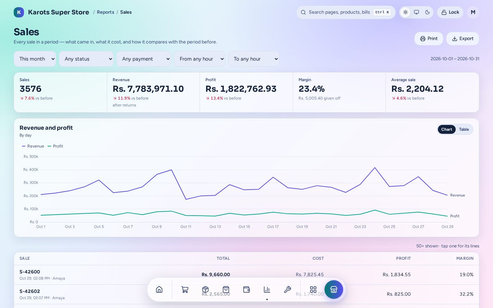
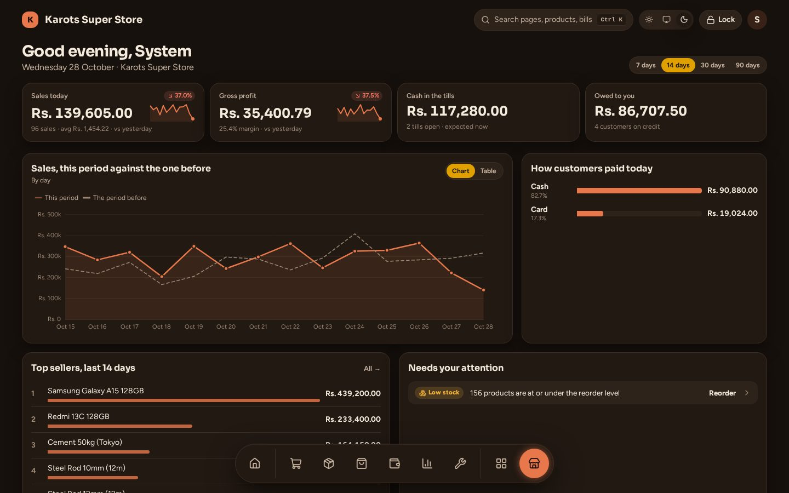
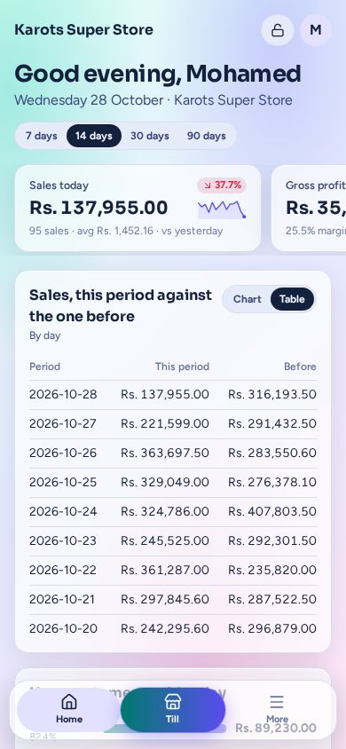
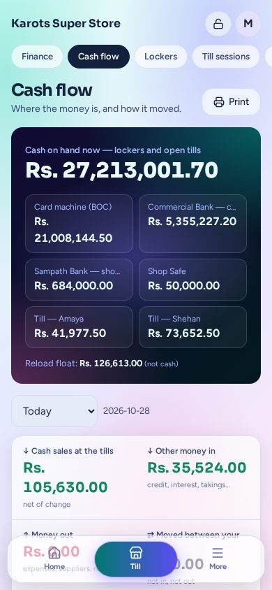
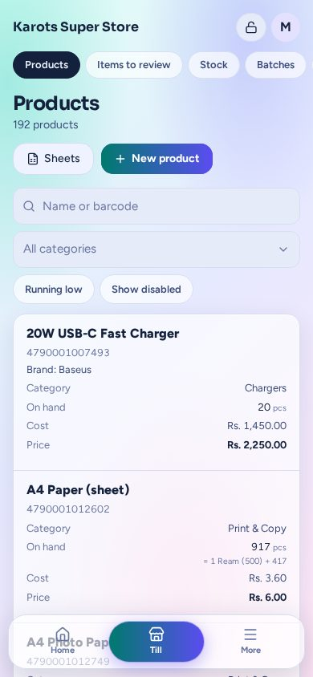
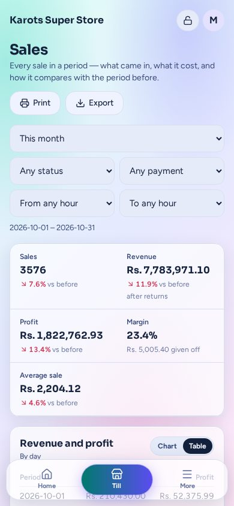
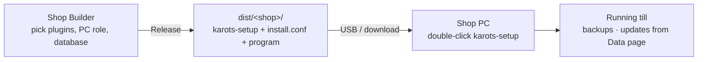

<p align="center">
  
</p>

<h1 align="center">Karots Suite</h1>

<p align="center">
  <b>The till, stock, purchasing, money and reports for a small Sri Lankan shop, in one program.</b><br>
  It runs on the shop's own PC, works without the internet, and a phone is enough to watch it.
</p>

<p align="center">
  
  
  
  
  
  
  
</p>

<p align="center">
  
</p>

---

## What it does

| | |
|---|---|
| **Sell fast at the counter.** Scan, search or tap a product; discounts, split payments, credit, holds, returns. Every key has an F-key, and the till never blocks a sale. <br><br> [Selling at the till →](docs/guide/till.md) |  |
| **Know your stock.** Batches and expiry, packs (a card of 10 sold whole or loose), stock-take, intake by scan, and reorder levels the suite learns on its own. <br><br> [Stock →](docs/guide/stock.md) |  |
| **Buy from suppliers.** Purchase orders, receiving with a GRN, supplier credit and returns, and a reorder list that turns into orders. <br><br> [Purchasing →](docs/guide/purchasing.md) |  |
| **Follow every rupee.** Till sessions with counted cash, lockers (safe, bank, card machine), expenses and a cash flow page that adds it all up. <br><br> [Money →](docs/guide/money.md) |  |
| **See how the shop is doing.** A live dashboard and 19 reports, all on a phone too, all exportable to Excel. <br><br> [Reports →](docs/guide/reports.md) |  |
| **Make it yours.** 22 colour palettes in light and dark, your own palettes, ten receipt styles and label styles. <br><br> [Appearance →](docs/guide/appearance.md) |  |

<p align="center">
  
  
  
  <br>
  <sub>Every admin page and report works on a 360 px phone.</sub>
</p>

## Plugins

A shop gets only the plugins it needs. Each one is compiled into that shop's program, and the
core never depends on any of them.

| Plugin | For |
|---|---|
| [Reload & Bills](docs/guide/plugins/recharge.md) | Mobile reloads, packages, bill payments and wallet cash in / out, with float and commission |
| [Pharmacy](docs/guide/plugins/pharmacy.md) | Patients, prescriptions (1-0-1), dispensing from the sale, refills, controlled-drug register |
| [Repairs](docs/guide/plugins/repairs.md) | Repair jobs from drop-off to pickup, deposits, tickets, warranty |
| [Print & Copy](docs/guide/plugins/documents.md) | Photocopy, print, laminate and bind, priced by size × type, with extras |
| [Alternatives](docs/guide/plugins/alternatives.md) | Interchangeable products and an in-stock swap at the till |
| [Clearance](docs/guide/plugins/clearance.md) | Margin-safe markdowns for slow and expiring stock |
| [AI Assistant](docs/guide/plugins/aicatalog.md) | Tidy the catalogue with any free chatbot, no API key |
| [Product Plus](docs/guide/plugins/productplus.md) | Extra product fields (brand, generic name, guarantee…) |
| [Combos](docs/guide/plugins/combos.md) | Bundles and buy-3-get-1 deals the till spots by itself |
| [Customer requests](docs/guide/plugins/requests.md) | Items customers asked for, and whom to call once they're in |

## How a shop gets it



One shop, one build: the program is a single file with the web app inside. A one-PC shop keeps
its database in a folder next to the program ("file mode"), and a shop with several PCs uses a
PostgreSQL server. Updates are signed and installed from **Setup → Data → Updates**.
[Install & Shop Builder →](docs/guide/install.md)

Want to see it first? The **Demo Room** is one double-click program with five ready-made shops,
each with a year of trade. [Demo Room →](docs/guide/demo-room.md)

## Guides

- **Shop owners and staff:** [Till](docs/guide/till.md) · [Stock](docs/guide/stock.md) ·
  [Purchasing](docs/guide/purchasing.md) · [Money](docs/guide/money.md) · [Reports](docs/guide/reports.md) ·
  [People & users](docs/guide/people.md) · [Printing](docs/guide/printing.md) · [Appearance](docs/guide/appearance.md) ·
  [Plugins](docs/guide/plugins/README.md)
- **Resellers and technicians:** [Install & Shop Builder](docs/guide/install.md) ·
  [Updates & backups](docs/guide/updates-backups.md) · [Demo Room](docs/guide/demo-room.md)
- **Developers:** [Architecture](docs/guide/architecture.md) · [Developer guide](docs/guide/developer.md)

All guides: [docs/guide](docs/guide/README.md).

## For developers

```bash
cp .env.example .env
make db-up          # PostgreSQL on :5433
make migrate
make dev            # Go (air) on :3100 + Vite on :5173, proxying /api
```

Open <http://localhost:5173>. Seed a starter shop with `go run ./cmd/server -seed`
(admin `0771234567` / `1234`).

```bash
make test           # Go
make test-web       # Vitest
make e2e-seed && (cd web && bunx playwright test)
make build && make verify-portable   # one static binary
```

Read [`AGENTS.md`](AGENTS.md) before changing anything: the layout, the rules (the core never knows a
plugin, money moves only through `cashflow`) and the hidden behaviours that must keep working. Then see the
[developer guide](docs/guide/developer.md).

## Licence

Karots Suite is proprietary software. © 2026 Karots Korp (Karots Dev). All rights reserved. See
[LICENSE](LICENSE) (licence and service terms) and the per-shop [Order Form](docs/legal/order-form.md);
[docs/legal](docs/legal/README.md) explains how they follow Sri Lankan law. Open-source components and their licences
are listed in [THIRD_PARTY_NOTICES.md](THIRD_PARTY_NOTICES.md).

Licensing and support: **adhnanmsa@gmail.com** · **0769626396**
