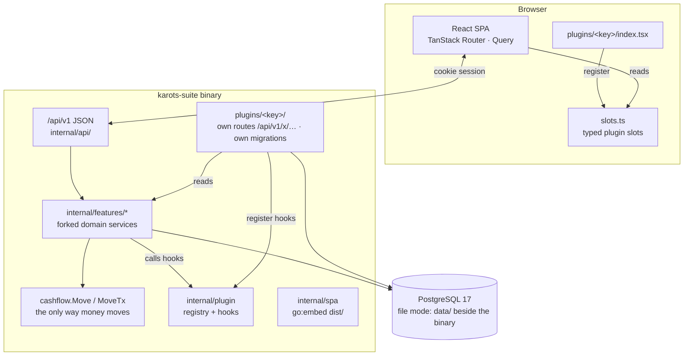

# Architecture

*For developers.* Karots Suite is a JSON-only Go server and a React single-page app, built into
**one static binary** per shop. [`AGENTS.md`](../../AGENTS.md) is the full rulebook; this page is
the map.

## Core and plugins

- **The core is plugin-inert.** Core Go and `web/src` (outside `web/src/plugins`) never import,
  name or branch on a plugin. `make check-core` fails the build if they do.
- **Plugins attach only through seams.** Go plugins call `plugin.Register` in `init()` and add
  routes on `reg.Admin()` / `reg.Cashier()` (served under `/api/v1/x/…`), their own migrations
  (`goose_db_version_<key>`) and hooks. React plugins register into the typed slots in
  `web/src/plugins/slots.ts`.
- **Composition root.** `cmd/server/enabled_plugins.go` and `web/src/plugins/enabled-plugins.ts`
  are generated by the Shop Builder for each build. They are committed core-only.
- **Plugins change each other's data only through hooks.** A plugin may read core or another
  plugin, but when something happens that others must react to (a product merged, a sale line
  returned), the side doing it calls the registry hook and each plugin fixes its own rows.
  Change hooks run inside the caller's transaction, so an error rolls everything back.

### Go hooks (`internal/plugin`)

Registered with `reg.Add…`: `TenderMethod`, `SaleLineHook`, `ReturnLineHook`, `ProductMerger`,
`CategoryMerger`, `ProductExtras`, `ProductSearchContributor`, `ProductDetailContributor`,
`ProductBadgeProvider`, `ProductMetaProvider`, `ProductLabelFieldProvider`,
`ProductSheetColumns`, `ProductReorderAnnotator`, `ProductSaleSuggestionProvider`,
`MoneyLocationProvider`, `ExpenseOwner`, `PLIncome`, `ActivityContributor`, `DataGroup`,
`ReadinessProvider`, `LogoutGuard`.

### React slots (`slots.ts`)

`apps`, `adminPages` (→ `/admin/x/<key>/*`), `tillMenu`, `tillActions`, `tillCartHints`,
`tillLineHints`, `drawerSections`, `tillTenders`, `tillTabs`, `tillReceiptKinds`,
`slipTemplates`, `labelTemplates`, `returnLineFields`, `reportCards`, `settingsSections`,
`productFormSections`, before / after sale. The till exposes `TillApi.addGroup` (line groups
kept together and printed as one block) and `TillApi.addPayout` (money given to the customer).

## Rules the code keeps

- **Money moves only through `cashflow.Move/MoveTx`.** Sales are the source of truth for revenue.
- **Domain logic is forked, not rewritten.** `internal/features/*` comes from Karots POS, and a
  bug found here is fixed in both.
- **Never stop a sale.** Sell first, then flag the oddity for review.
- **Desktop till, mobile admin.** Every admin page works at 360 px; the till is desktop / kiosk.
- **Theme tokens only.** No raw colours, pixel corners or literal timings (`theme/guard.test.ts`).
  Every screen works with all 22 palettes in light and dark.
- **Files stay at 500 lines or fewer**, organised by concern.
- **Thermal printing stays in Go** (`internal/escpos`). Image-mode slips are drawn in React
  (`features/print`) and sent as pictures. A4 documents are React print routes.

## API

- Everything is under `/api/v1`. Fields are camelCase, money is a decimal string, and dates are
  ISO 8601. Errors are `{"error":{"code","message"}}`.
- The session is the httpOnly `pos_token` cookie (SameSite=Strict); JS never sees a token. The
  SPA routes on `UNAUTHORIZED`, `SESSION_LOCKED` and `PIN_CHANGE_REQUIRED`.
- Request and response types live in `internal/api/dto*.go`. `make types` generates
  `web/src/api/types.gen.ts` with tygo.

## Deployment shapes

| | File mode | Server mode |
|---|---|---|
| Database | Embedded PostgreSQL 17 in `data/` beside the binary (`-tags filemode`) | A PostgreSQL 17 server via `DATABASE_URL` |
| For | One-PC shops | Several PCs, or a VPS |
| Backups | `data/backups` | `BACKUP_DIR` |

Updates are signed manifests in the shop's bucket folder (`internal/update`). A restart is exit
code 75, which the supervisor (systemd or Karots' start task) restarts. A failed boot rolls back
to the previous binary.
