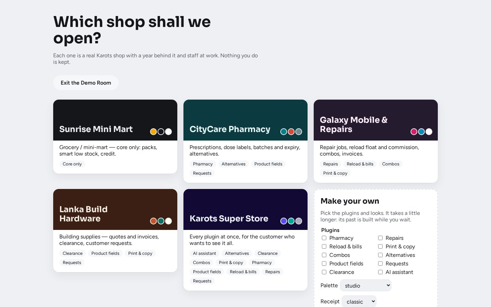

# Demo Room

*For showing Karots Suite to a customer.* The Demo Room is a single program
(`karots-suite-demo-room` for Linux, `.exe` for Windows). Double-click it and a browser opens on
a choice of shops. Each one is the real suite, with a year of trade behind it and staff selling
right now. It works offline, and nothing is kept: every shop starts fresh and is wiped when the
demo closes.

## The shops

| Shop | Shows |
|---|---|
| **Sunrise Mini Mart** | Grocery, core only: packs, smart low stock, credit |
| **CityCare Pharmacy** | Prescriptions, dose labels, batches and expiry, alternatives |
| **Galaxy Mobile & Repairs** | Repair jobs, reload float and commission, combos, invoices |
| **Lanka Build Hardware** | Quotes and invoices, clearance, customer requests |
| **Karots Super Store** | Every plugin at once (all the screenshots in these guides come from it) |
| **Make your own** | Pick plugins, a palette and a receipt style. Slower, because its past is built while you wait |

Each shop opens in its own palette within about half a minute. The sign-in page lists the shop's
demo logins (owner, manager, cashiers); tap one to sign in.

## Unlocking

The demo opens on a lock page showing its install ID. Enter the hourly code for that ID from
the Karots PIN app. Five wrong codes make it wait a minute. A copy left on a customer's PC is
useless without the code, and the left-edge **Demo** tab always shows the owner's contact.

## While it runs

- **Printers:** a sale's receipt slides out on the paper strip, a label prints as a sticker, and
  the drawer kick shows. **Prints** keeps every slip.
- **Cheat menu** (Ctrl+Shift+D, or five taps on the Demo tab):
  - Open tills, make it busy (20 sales now), jump to closing time.
  - Push products to low stock, put a credit customer over their limit, bring in a supplier
    delivery, print a test receipt and label.
  - Next palette, next receipt style.
  - One move per plugin: a repair job, a reload, a print job, a combo, a prescription, a
    customer request.
  - Reset the shop.
- **Pause** stops the staff's own sales. **Switch shop** asks first, then goes back to the
  picker. Invoices and statements printed or saved as PDF carry a diagonal **DEMO** mark.

## Building it

`make demo` builds both programs into `dist/demo/`, with every built-in shop's year inside. The
first build takes about six minutes, and the years are reused until something that shapes them
changes. It needs `POS_SUPPORT_SECRET` in `.env`. `make demo-dev` runs a quick one on this machine.
