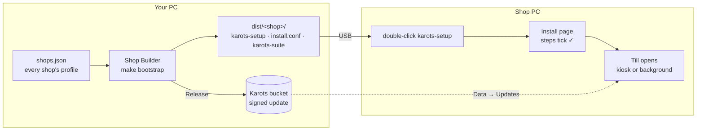

# Install & Shop Builder

*For resellers and technicians.* A shop never types a command. You build the shop on your own
PC with the **Shop Builder**, carry three files to the shop, and double-click **karots-setup**
there.

## 1. The shop's profile

`make bootstrap` opens the Shop Builder in your browser. The **Shops** list holds one profile per
shop (kept in `shops.json`), with:

- **Name** and **plugins**. A plugin that needs another brings it along (Pharmacy needs Product
  Plus and Alternatives).
- **OS:** Windows or Linux.
- **Database:**
  - **One PC (file mode):** the shop's own PostgreSQL 17 lives in a `data/` folder next to the
    program. Nothing else to install.
  - **Server:** a PostgreSQL server on this PC or another, for shops with several PCs.
- **Ports**, generated **secrets**, the shop's **install ID** (its support PIN comes from it),
  and the update **channel**.
- **Open:** **kiosk** (the till full-screen at login) or **background** (an owner's own PC:
  Karots starts quietly and a desktop shortcut opens it in the normal browser).
- An optional **backup copy folder** and **Karots cloud** backup (see
  [Updates & backups](updates-backups.md)).

**Quick build** makes a one-off build without saving a profile.

## 2. Build

- **Release…** builds the shop and publishes the update to the shop's folder in the Karots
  bucket. **A shop's first install must be a Release**, or its Data page will say "No update
  published". Release refuses to build from uncommitted code.
- **Test build** builds on your PC only. The Data page shows it as a test build.
- Untick **Add installer** to get the program alone.
- On Windows server mode, tick **+ PostgreSQL** to put the PostgreSQL installer beside the files,
  so Setup doesn't need the internet.

The result is `dist/<shop>/`, three files: `karots-setup`, `install.conf` (the settings and
secrets; keep it private) and the program.

## 3. Install at the shop

Copy the folder to the shop PC and double-click **karots-setup**. It asks for admin rights the
normal way (UAC on Windows, the password box on Linux) and opens a page:

1. **This PC is…** the shop's **main PC**, or a **cashier PC** that opens the main PC's till
   full-screen (with a **Test** button for the address).
2. **What will happen:** plain lines, all decided by the Builder.
3. **I agree:** the shop ticks that it has read and agrees to the Licence and Service Agreement and the Shop
   Rules & Service Guide (both open from the links). Install stays off until it's ticked, and Setup keeps a record in
   `terms-accepted.txt` in the install folder.
4. **Install:** each step ticks ✓. These are checks, the database, the program, the settings,
   the backup folder, start with the PC, the firewall, printing (CUPS on Linux), opening the
   till, and a final health check. A failed step says what to do and offers **Try again**.
   **Copy log** is there for support.

Windows file mode carries the Visual C++ runtime PostgreSQL needs, so a fresh Windows works.
A Linux server with no screen runs `sudo ./karots-setup -yes -accept-terms` (the flag is the shop accepting the terms).

## Changing a shop later

Change the profile, build again, carry the files, and run **karots-setup → Update**. Data is
untouched. Moving between **file and server mode** is noticed there: tick **Change it** and Setup
backs up, switches modes and restores.

## Moving a shop to another PC

1. On the old PC: **karots-setup → Uninstall**. It takes a final backup first, kept in
   `C:\Karots backups` or `~/Karots backups`. If the backup fails, nothing is removed.
2. On the new PC: the three files plus that backup. Setup offers it under **Bring back a shop**.

## Remote access

Owners who want to watch the shop from home use Tailscale to reach the shop PC. The suite itself
stays on the shop's network.
