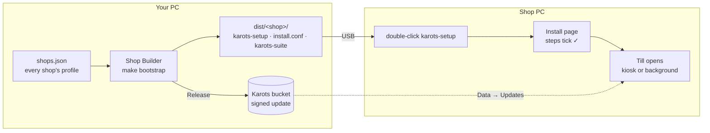

# Install & Shop Builder

*For resellers and technicians.* A shop never types a command. You build the shop on your own
PC with the **Shop Builder**, carry its folder to the shop, and double-click **karots-setup**
there.

## The shop's PC

The main PC (the one that runs Karots Suite):

| | Minimum | Recommended |
|---|---|---|
| **Operating system** | Windows 10 (64-bit), or a 64-bit Linux | Windows 10 or 11 (64-bit), or Ubuntu / Xubuntu |
| **Processor** | Intel Core 2 Duo, or any 64-bit Intel / AMD with 2 cores | Intel Core i3 2nd gen or newer, or AMD equal |
| **Memory** | 2 GB | 4 GB or more |
| **Storage** | 5 GB free, hard disk | 20 GB free, SSD |
| **Screen** | 1024 × 768 (the till's two-column layout) | 1366 × 768 or larger (three columns) |
| **Network** | One PC alone: none. More devices (cashier PCs, phones, Karots Shelf): a wifi router or wired network in the shop | A wifi router, the main PC on a cable to it, plus internet now and then (updates, cloud backup) |
| **Receipt printer** | Optional | 80 mm thermal on USB (tested: Xprinter XP-80T) |
| **Power** | A normal socket (a power cut loses no finished sale) | A UPS, to keep selling through a cut |

**Cashier PCs** only show the till in a browser from the main PC: Windows 10 / 11 or Linux, 2 GB, a 1024 × 768
screen, and Chrome, Edge or Firefox from 2023 or later. They need no licence.

Why these: the program is built for any 64-bit x86 CPU (`GOAMD64=v1`, no AVX needed) and the Go it is built with
needs Windows 10 or newer; 32-bit systems don't run it. Disk, measured: the program 46 MB, its own PostgreSQL 59 MB,
a busy shop's year of data 271 MB and a week of backups (28) about 160 MB, so about 0.5 GB after a year.

Measured on the main PC holding a year of a busy shop (~40,000 sales, ~2,000 products), with
`scripts/bench` (till search, sales, the year's reports, a backup through the real API) on a VM slowed to each PC:

| PC | Till search (p95) | Sale (p95) | Finance, a year | Sales report, a year | Backup | Start |
|---|---|---|---|---|---|---|
| i3 2nd gen, 4 GB, SSD | 0.11 s | 0.02 s | 1.6 s | 2.3 s | 2.3 s | 0.7 s |
| i3 2nd gen, 4 GB, hard disk | 0.12 s | 0.04 s | 1.6 s | 2.9 s | 2.5 s | 2.1 s |
| Core 2 Duo, 2 GB, hard disk | 0.30 s | 0.06 s | 2.5 s | 4.0 s | 4.3 s | 4.2 s |

The Core 2 Duo works but is at the edge: search reaches the 0.3 s a cashier notices, and a year's
report nears 5 s as a shop grows. One core with 1 GB still works but slowly (search 0.6 s, already
swapping); 512 MB does not (a search took minutes). A cashier PC only shows the till in a browser,
so any PC that runs a current browser will do.

## 1. The shop's profile

`make bootstrap` opens the Shop Builder in your browser. The **Shops** list holds one profile per
shop (kept in `shops.json`), with:

- **Name** and **plugins**. A plugin that needs another brings it along (Pharmacy needs Product
  Plus and Alternatives).
- **OS:** Windows or Linux.
- **Database:**
  - **Built in (file mode):** the shop's own PostgreSQL 17 lives in a `data/` folder next to the
    program on the main PC. Nothing else to install. Cashier PCs and phones work with it over the
    shop's network, as long as the main PC is on.
  - **Server:** a PostgreSQL server you look after, on this PC or another (a VPS, say).
- **Ports**, generated **secrets**, the shop's **install ID** (its support PIN comes from it),
  and the update **channel**.
- **Open:** **kiosk** (the till full-screen at login) or **background** (an owner's own PC:
  Karots starts quietly and a desktop shortcut opens it in the normal browser).
- An optional **backup copy folder** and **Karots cloud** backup (see
  [Updates & backups](updates-backups.md)).

**Quick build** makes a one-off build without saving a profile.

## 2. Build

- **Release…** builds the shop and publishes the update to the shop's folder in the Karots
  bucket. **A shop's first install must be a Release**, or its Data page will say "No update
  published". Release refuses to build from uncommitted code or from code `make test-all` hasn't passed (changes to `docs/`, `shops.json` and the plugin lists don't count), and commits `shops.json` by itself once published.
- **Test build** builds on your PC only. The Data page shows it as a test build.
- Untick **Add installer** to get the program alone.
- On Windows server mode, tick **+ PostgreSQL** to put the PostgreSQL installer beside the files,
  so Setup doesn't need the internet.

The result is `dist/<shop>/`: `karots-setup` and `karots-setup.exe`, `install.conf` (the settings and
secrets; keep it private) and the program. Copy the whole folder. A cashier PC can run another system
than the main PC, such as a Windows cashier with a Linux main PC: use that system's Setup and choose
**A cashier PC**. The main PC must run the system the shop was built for; Setup refuses otherwise.

## 3. Install at the shop

Copy the folder to the shop PC and double-click **karots-setup**. It asks for admin rights the
normal way (UAC on Windows, the password box on Linux) and opens a page:

1. **This PC is…** the shop's **main PC**, or a **cashier PC** that opens the main PC's till
   full-screen (with a **Test** button for the address).
2. **What will happen:** plain lines, all decided by the Builder.
3. **I agree:** the shop ticks that it has read and agrees to the Licence and Service Agreement and the Shop
   Rules & Service Guide (both open from the links). Install stays off until it's ticked, and Setup keeps a record in
   `terms-accepted.txt` in the install folder.
4. **Install:** each step ticks ✓. These are checks, the database, the program, the settings,
   the backup folder, start with the PC, the firewall, printing (CUPS on Linux), opening the
   till, and a final health check. A failed step says what to do and offers **Try again**.
   **Copy log** is there for support.

Windows file mode carries the Visual C++ runtime PostgreSQL needs, so a fresh Windows works.
A Linux server with no screen runs `sudo ./karots-setup -yes -accept-terms` (the flag is the shop accepting the terms).

## Changing a shop later

Change the profile, build again, carry the files, and run **karots-setup → Update**. Setup backs
the shop up to the Karots backups folder first (nothing changes if that fails); data is untouched. Moving between **file and server mode** is noticed there: tick **Change it** and Setup
backs up, switches modes and restores.

## Moving a shop to another PC

1. On the old PC: **karots-setup → Uninstall**. It takes a final backup first, kept in
   `C:\Karots backups` or `~/Karots backups`. If the backup fails, nothing is removed.
2. On the new PC: the shop's folder plus that backup. Setup offers it under **Bring back a shop**.

## Remote access

Owners who want to watch the shop from home use Tailscale to reach the shop PC. The suite itself
stays on the shop's network.
