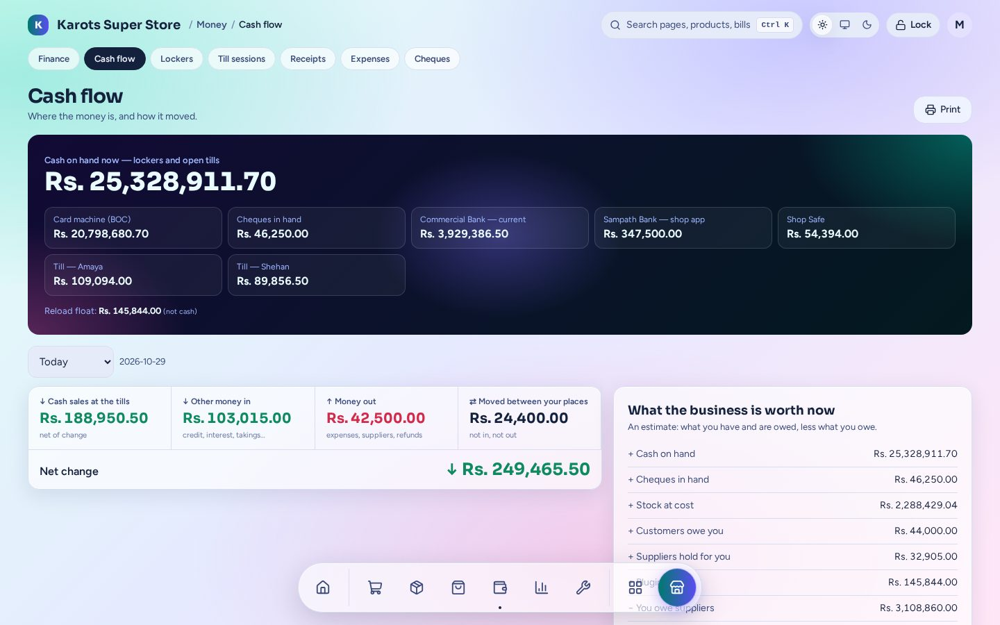
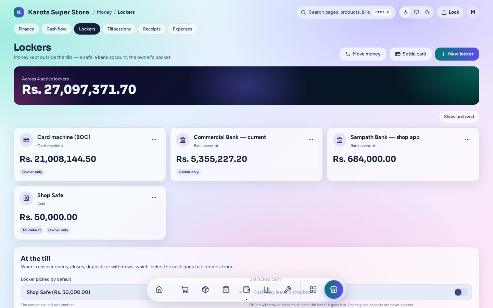
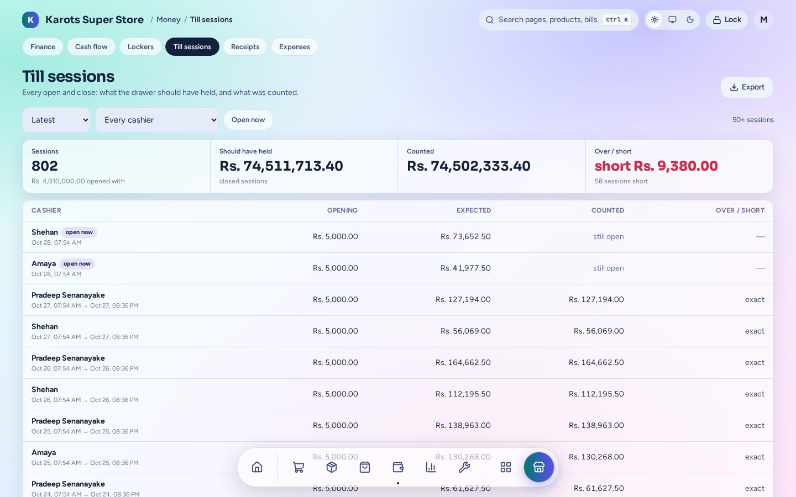
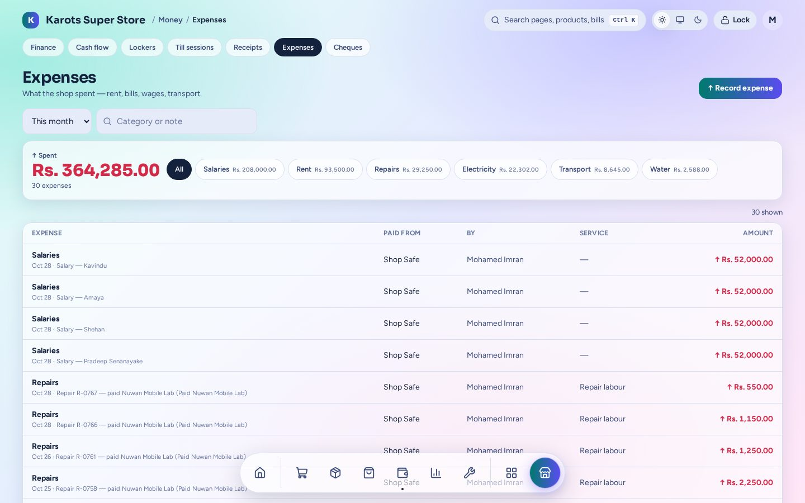
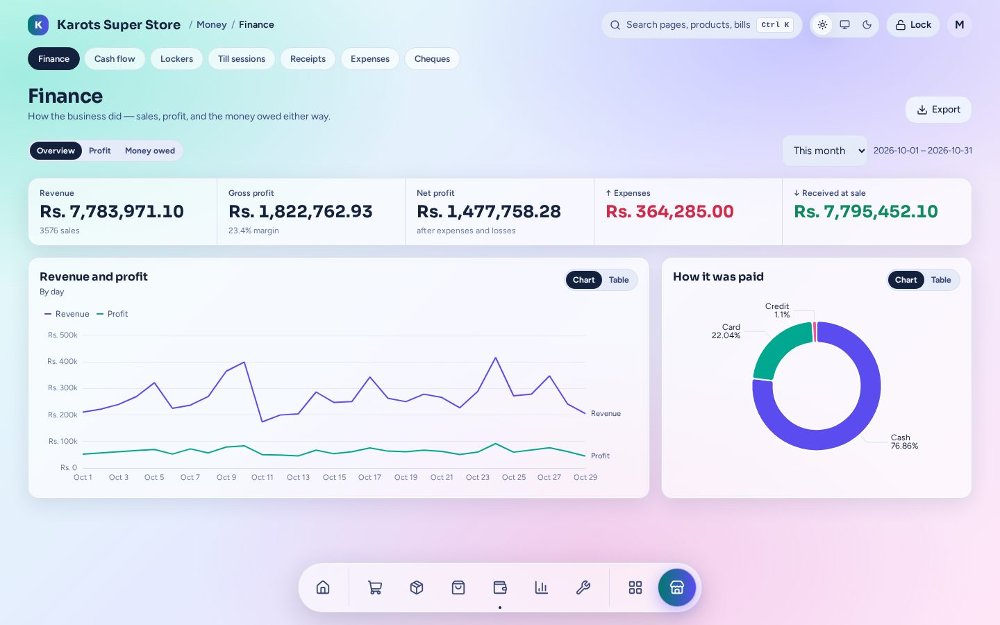
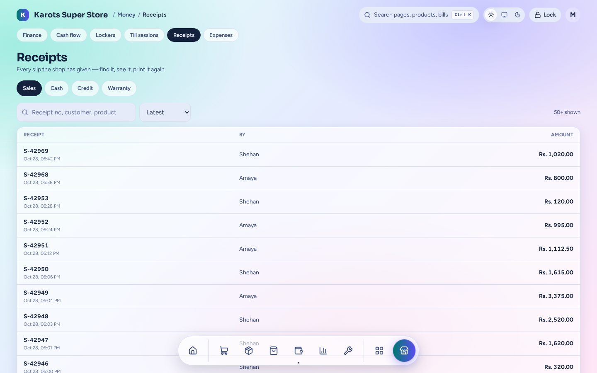

# Money

Every rupee that moves is recorded once, in one place, so the till, the lockers, the reports and
the cash flow always agree. Sales are the source of truth for revenue. You'll find it under
**Money**.

## Cash flow

**Cash on hand now** adds up the lockers and the open tills. Below that, for the day or range you
pick: cash sales at the tills, other money in (credit collected, interest, takings), money out
(expenses, suppliers, refunds), money moved between your places, and the net change. **What the
business is worth now** estimates cash, stock at cost, what customers owe and what you owe.

## Lockers

A locker is anywhere money is kept outside the tills: a safe, a bank account, the card machine,
the owner's pocket.

- **Move money** between lockers. **Settle card** when the card machine pays into the bank.
- Choose which locker a till's deposits and withdrawals go to by default, and whether the
  cashier may pick another.
- A locker can be **owner only**.

## Till sessions

Every open and close: the opening float, what the drawer should have held, what was counted, and
the over or short. Open a session for its **Z report**. A till left open is marked **open now**,
and an admin or manager can close it for the cashier.

## Expenses

Rent, electricity, wages, transport. Record one from a locker or let a cashier pay it from the
drawer at the till. An expense can be tagged to a service (such as the photocopier's
maintenance) so that service's profit is right. A wrong one can be voided.

## Finance

Revenue, gross profit, net profit after expenses and losses, what was received at sale, and how
customers paid, for any range. The **Profit** tab is the P&L, and **Money owed** shows both
directions.

## Receipts

Every slip the shop has given (sales, cash, credit and warranty). Find one, look at it, print it
again, or take goods back.
