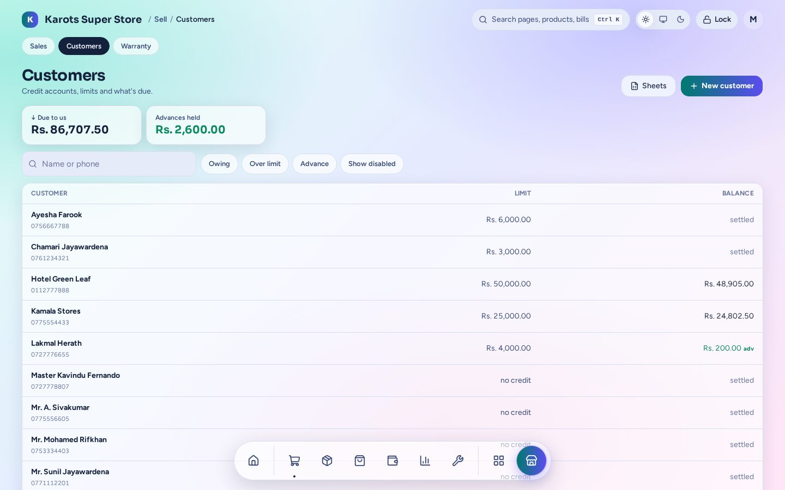
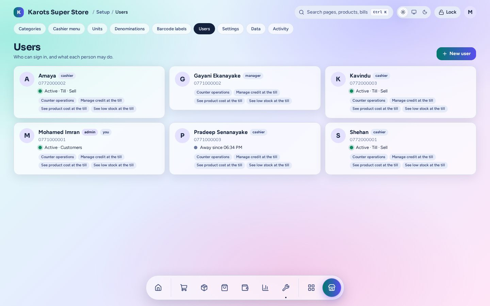
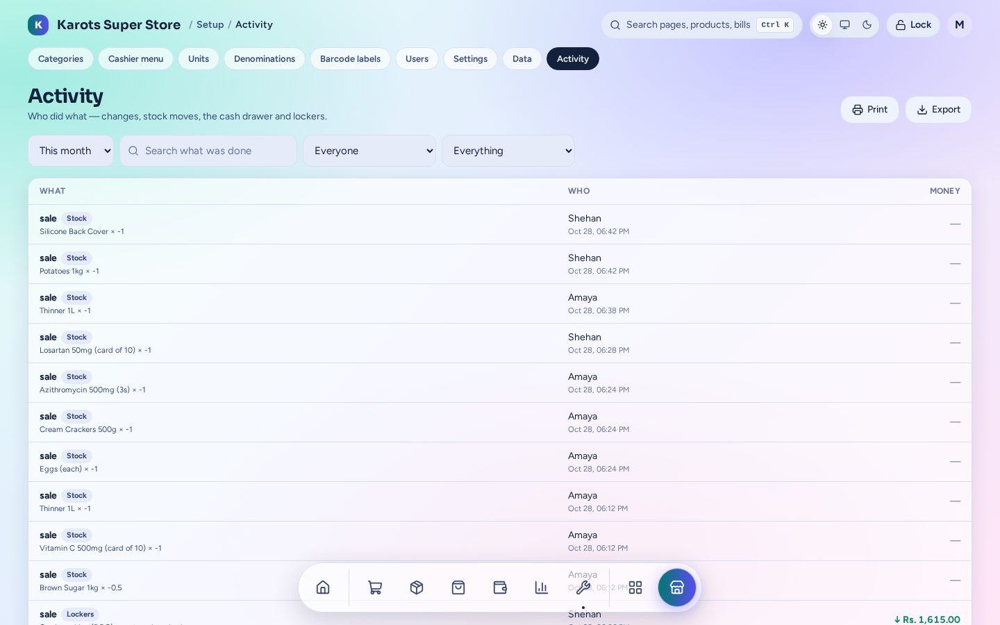

# People & users

## Customers

Walk-in customers need nothing. A **credit customer** has a phone number, a credit limit and a
running balance:

- Sell **on account** at the till. A cashier can't go past the limit; an admin can approve it.
- Take payments and advances at the till's [Credit tab](till.md#credit) or here. Change a
  customer leaves can be kept as an advance for next time.
- Enter an **old balance** from before the suite as an opening balance.
- Print a **statement** for any period.
- Import or export customers with **Sheets**.

The top of the page shows what customers owe you in total and the advances you hold.

## Users and rights

Admins add staff logins here. Each login is a phone number and a PIN.

| Role | Can |
|---|---|
| **Admin** | Everything, including users, settings and data |
| **Manager** | The admin pages (stock, purchasing, money, reports, settings) except users, data and Activity |
| **Cashier** | The till and the counter tabs their rights allow |

Each cashier has rights you switch on: **counter operations** (pay suppliers, take in deliveries, place orders and record expenses at
the till; they will see cost prices),
**manage credit at the till**, **see product cost at the till** and **see low stock at the till**.
A user can also have their own receipt printer.

- With **force PIN change** on in Settings, a new user picks their own PIN the first time they
  sign in.
- A new PIN from an admin signs that user out everywhere.
- The last admin can't be removed or demoted.

## Locking

The till and admin pages lock after the idle time set in **Settings**, or straight away with
**Lock**. The same user or any admin can unlock. PIN fields never let the browser remember a PIN,
because the counter PC is shared.

## Who's on now and Activity

The dashboard shows every signed-in screen: who, on which device, on which page, and when the
lock screen is up. **Activity** is the audit trail: who did what, with the money and stock it
moved, filterable by person and kind.

