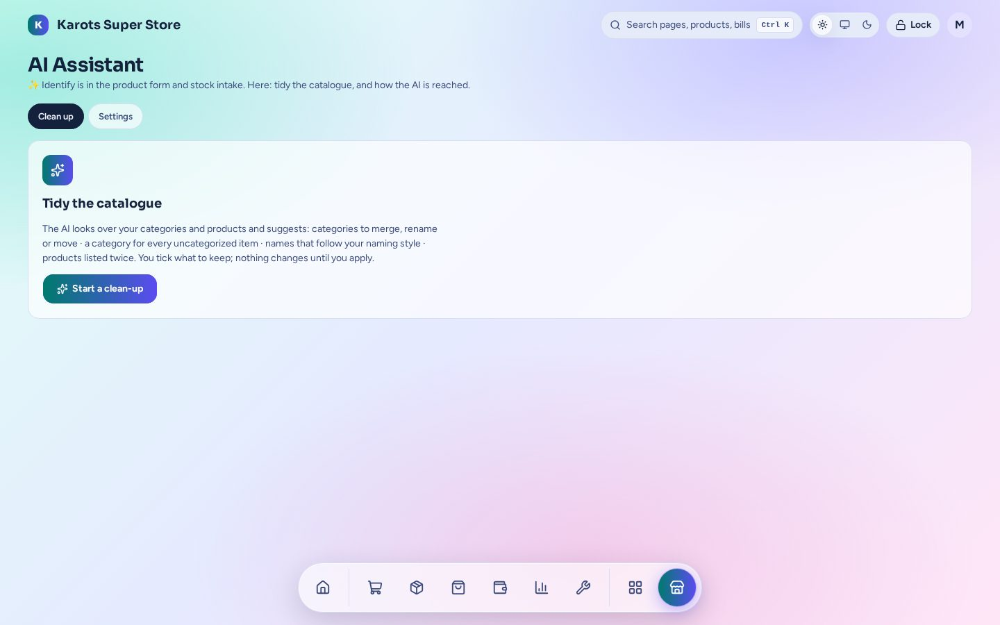

# AI Assistant

Catalogue help for whoever sets the shop up. It works with any free chatbot by copy and paste, with no API key.

- **✨ Identify** inside the product form and intake: paste a name or code and get the details filled in.
- **Clean up**: tidy categories, fill in uncategorised items, fix names in your naming style and find duplicates to merge.
- You tick what to keep. Nothing changes until you apply it.

The admin page is under **Apps → AI Assistant** (`/admin/x/aicatalog`). A shop has this plugin only if it was built with it ([Install & Shop Builder](../install.md)).
