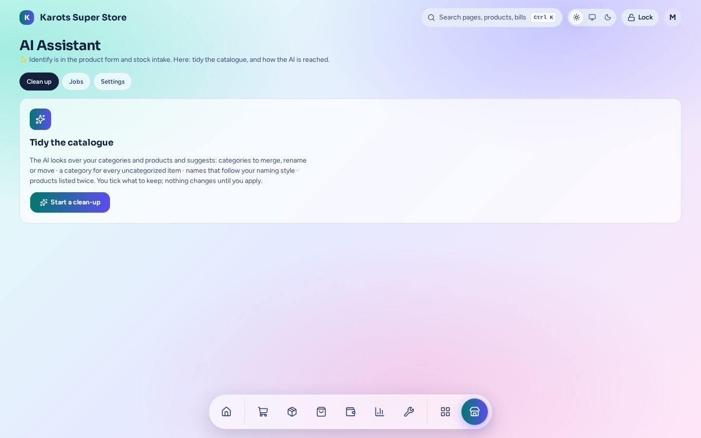
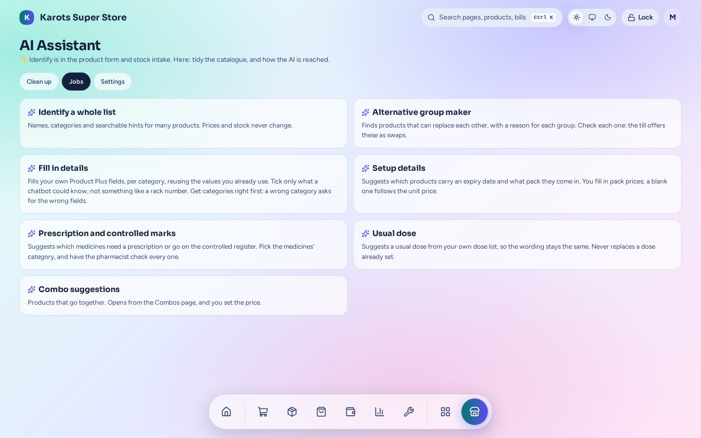

# AI Assistant

Help for whoever sets the shop up, and for the new cashier who doesn't know the stock yet. It works with any free chatbot by copy and paste, with no API key.

- **✨ Identify** inside the product form and intake: paste a name or code and get the details filled in.
- **Hints:** what the chatbot said about a product is kept and searchable. A customer asks for a brake pad for a CT100, the cashier types "CT100", and the part comes up even if its name is only a part number. Hints show on the till's result and in ⓘ, marked as an AI hint, and you can correct them on the product page.
- **Clean up** tidies categories, fills in uncategorised items, fixes names in your naming style and finds duplicates to merge. A big catalogue goes in parts, and **Continue where you left off** picks up on the same device.
- **Jobs** do the same for many products at a time. You choose how many at once, down to one for checking quality.
- You tick what to keep. Nothing changes until you apply it, and **Undo it** puts back the last apply, unless someone has changed that value since.

A hint comes from a chatbot, so confirm it before relying on it. Two chatbots can give different vehicle lists for the same part, and both can say they're sure.

## Jobs

| Job | Shows when | What it suggests |
|---|---|---|
| **Identify a whole list** | Always | Name, category and hint. Hints start ticked; a category starts ticked only if the product has none; names start unticked, with **Tick all names** once you've looked. An old name stays searchable after a rename. With [Product Plus](productplus.md), tick **Also fill these fields** (a generic name, say) and the same answer fills them, judged by the category it gives; these start ticked and **replace** a value already there |
| **Setup details** | Always | Which products carry an expiry date, and their pack size. You fill in pack prices; a blank one follows the unit price |
| **Alternative group maker** | [Alternatives](alternatives.md) is in the build | Products that can replace each other, with a reason for each group. Also from **Suggest groups** on the Alternatives page |
| **Fill in details** | [Product Plus](productplus.md) is in the build | Your own fields, only the ones you tick, per category, reusing the values you already use. Don't tick something only your shop can know, like a rack number |
| **Prescription and controlled marks** | [Pharmacy](pharmacy.md) is in the build | Which medicines need a prescription or go on the register. Every mark starts unticked. **No suggestion doesn't mean cleared**, so the pharmacist still checks the list |
| **Usual dose** | [Pharmacy](pharmacy.md) is in the build | A dose in your dose list's own wording. The pharmacist approves one at a time, and it never replaces a dose already set |
| **Combo suggestions** | [Combos](combos.md) is in the build | Products that go together, from **Suggest combos** on the Combos page. It opens the normal combo form: you set the price and save |

A product leaves a job's list once it's been answered, so a long list keeps moving, and each step says where it stands: "Batch 2 of 6: products 6–10 of 27". Leave halfway and **Continue** carries on with the rest next time. **Skipped or no answer** brings back the ones you left, **Redo a product** shows the old and new side by side, and **Redo everything** does that for the whole list. If the chatbot isn't sure, the product simply has no suggestion.

Fill in details, the marks and doses rely on the right category, so run **Identify a whole list** or **Clean up** first. Use the category filter so cleaning items aren't asked about prescriptions.

Tell the chatbot about your shop in **Settings → Custom instructions**: it goes into every prompt.

The admin page is under **Apps → AI Assistant** (`/admin/x/aicatalog`). A shop has this plugin only if it was built with it ([Install & Shop Builder](../install.md)).
