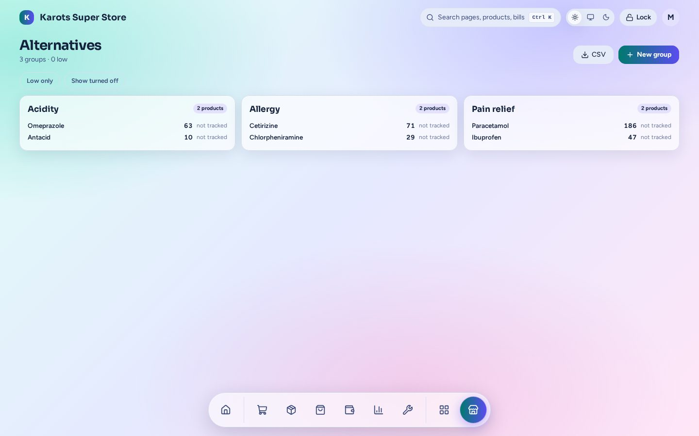

# Alternatives

Group products that can stand in for each other, such as two brands of the same medicine or two qualities of a cable.

- A **group** of interchangeable products, with optional **quality tiers**.
- The till's search finds the whole group. When a line is short of stock, the till offers an **in-stock swap**, and product info lists the alternatives.
- The **Reorder** page and the till's **Low stock** tab judge stock per tier, so you don't order a brand while its twin is full on the shelf. A low group shows as one block with all its brands.
- **The level learns by itself.** A group's level is the levels of its products added up, so it follows the [smart reorder levels](../stock.md#smart-reorder-levels). Type a number to set your own; a typed 0 means don't track it as a group. **Use Auto** goes back.
- **The order follows what sells.** A low group orders twice its level less what's left, split by each brand's sales over the last 90 days. Choose **Manual** to set the shares yourself; if another brand starts selling faster you get a suggestion, and nothing changes until you use it.

The admin page is under **Apps → Alternatives** (`/admin/x/alternatives`). A shop has this plugin only if it was built with it ([Install & Shop Builder](../install.md)).
