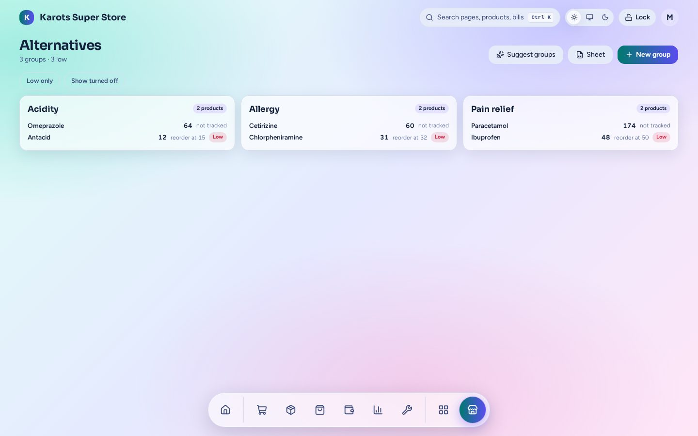

# Alternatives

Group products that can stand in for each other, such as two brands of the same medicine or two qualities of a cable.

- A **group** of interchangeable products, with optional **quality tiers**.
- The till's search finds the whole group. When a line is short of stock, the till offers an **in-stock swap**, and product info lists the alternatives.
- The **Reorder** page and the till's **Low stock** tab judge stock per tier, so you don't order a brand while its twin is full on the shelf. A low group shows as one block with all its brands.
- **The level learns by itself.** A group's level is the levels of its products added up, so it follows the [smart reorder levels](../stock.md#smart-reorder-levels). Type a number to set your own; a typed 0 means don't track it as a group. **Use Auto** goes back.
- **The order follows what sells.** A low group orders twice its level less what's left, split by each brand's sales over the last 90 days. Choose **Manual** to set the shares yourself (when a brand leaves the group — removed, moved or merged away — the others' shares are scaled back up to 100%, or the group goes back to Auto if none is left); if another brand starts selling faster you get a suggestion, and nothing changes until you use it.

## Grouping in a spreadsheet

**Sheet ▾** on the Alternatives page exports every group (CSV, Excel or ODS) and imports one back. One row per product:

| Group | Tier | Product | Barcode |
|---|---|---|---|
| Rice 1kg | | Anchor rice 1kg | 4790001002030 |
| USB flash drive 32GB | Genuine | SanDisk 32GB | |
| USB flash drive 32GB | Cheap | Generic 32GB | |

- **The sheet is the whole set.** After an import your groups are exactly what it says: a group or product it leaves out is taken out. You see a preview first — groups added and removed, products placed, moved and taken out, and any line skipped with its line number and why — and nothing changes until you press **Replace**.
- A product is found by its barcode, then by its exact name (capitals and spaces don't matter), so a sheet made outside the shop fits. A product is never created.
- A group that stays keeps what a sheet can't hold: on / off, a typed reorder level and a hand split.
- Leave **Tier** blank for a group without tiers.
- Only an admin can import; a manager can export.

**Let an AI do the grouping.** Export your products (Setup → Data → Spreadsheets → Products, with your extra fields such as Brand or Size), give the file to any AI and ask: "group the products that can replace each other — same item, same size — into a sheet with the columns Group, Tier, Product, Barcode". Import its answer here and check the preview.

The admin page is under **Apps → Alternatives** (`/admin/x/alternatives`). A shop has this plugin only if it was built with it ([Install & Shop Builder](../install.md)).
