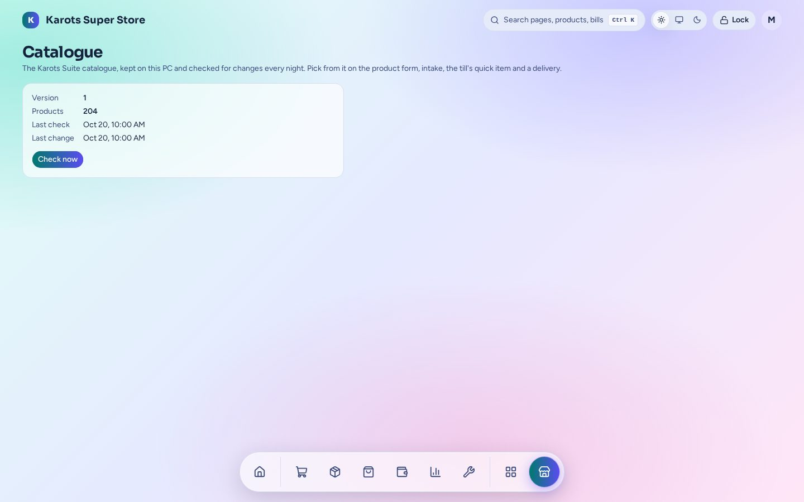
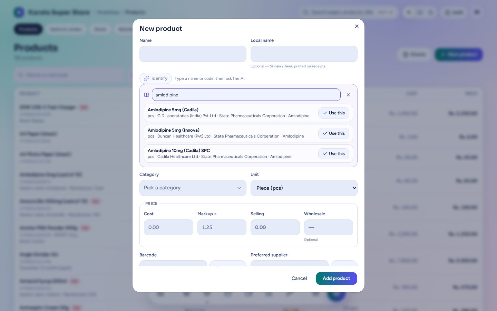

# Catalogue

Make a product from the Karots Suite catalogue instead of typing it: tens of thousands of real Sri Lankan products,
kept on the shop's main PC and checked for changes every night.

- **From catalogue** sits under the name on the product form, intake's new item, the till's **quick item** (on Pocket
  Cashier too, while the PC answers) and a delivery's new product line. Search by name, generic name or company, in
  any order, and press **Use this**: the name, the unit and **your own** [Product Plus](productplus.md) fields with
  the same names fill in (a field you already typed is kept). Never a price, cost, barcode, category or stock: those
  stay yours.

  

- A result you already have says **You have it**, so you don't make it twice.
- **A pick on the New product form or Intake's new item is done**: you set its category and prices there, so it
  doesn't go to review. **A pick on the till's quick item or a delivery's new line waits on Items to review** ("From
  the catalogue") until someone finishes it and presses **Mark reviewed**.
- **When the catalogue fixes something you took** (a name, a generic name…), the product shows on Items to review
  with what changed, old → new. **Use the catalogue's** takes the fix; **Keep mine** leaves your product as it is.
  Nothing changes by itself, and your own changes never go back to the catalogue. The unit is never changed later.
- **No internet?** The copy is on the PC, so search and picks keep working. A PC that never had a copy says so, and
  you type the product in. Cashier PCs and [Karots Shelf](../shelf.md) search the main PC's copy; a phone off the shop
  network types by hand.
  Nothing ever stops a form or a sale.
- **Apps → Catalogue** shows the copy's version, how many products it holds, the last check and **Check now**. A
  failed check (no internet, a broken download) says why and leaves the copy as it was.

The admin page is under **Apps → Catalogue** (`/admin/x/catalogue`). A shop has this plugin only if it was built with
it ([Install & Shop Builder](../install.md)).
