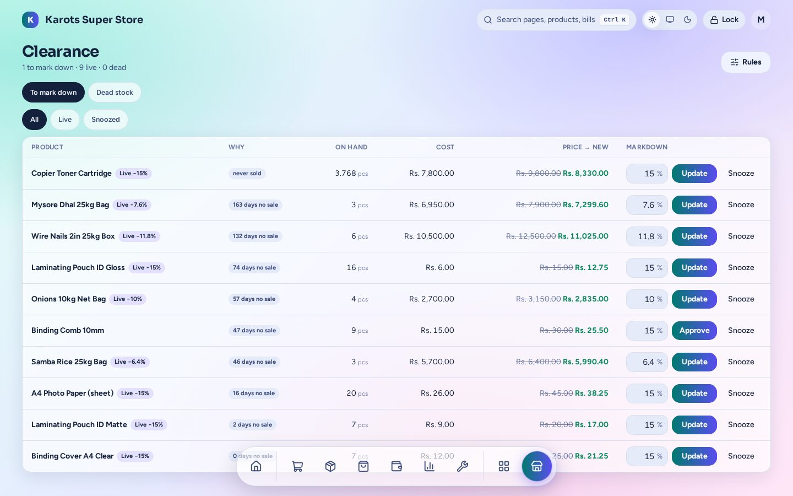

# Clearance

Mark down slow and expiring stock before it becomes a loss.

- The page lists what to mark down and why (never sold, days without a sale, close to expiry), with stock, cost and a suggested new price.
- Every markdown is **margin-safe**. The cashier is offered it at the till, and it ends by itself once that stock is gone.
- **Snooze** an item and it comes back after a while. **Rules** set what counts as slow. **Dead stock** can be retired in one go.

The admin page is under **Apps → Clearance** (`/admin/x/clearance`). A shop has this plugin only if it was built with it ([Install & Shop Builder](../install.md)).
