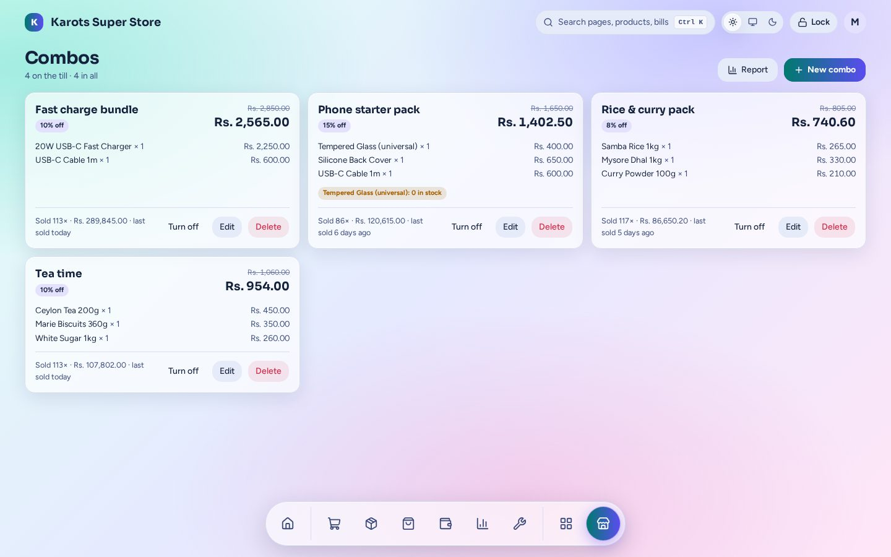

# Combos

Product deals: a group of products, or one product in bulk such as buy 3 get 1 free.

- Priced as **% off, Rs off or a set price**, between optional dates.
- The till rings a combo as **real lines kept together** and spots a combo as its items are scanned.
- A **report** shows what each combo sold and what it gave away.

The admin page is under **Apps → Combos** (`/admin/x/combos`). A shop has this plugin only if it was built with it ([Install & Shop Builder](../install.md)).
