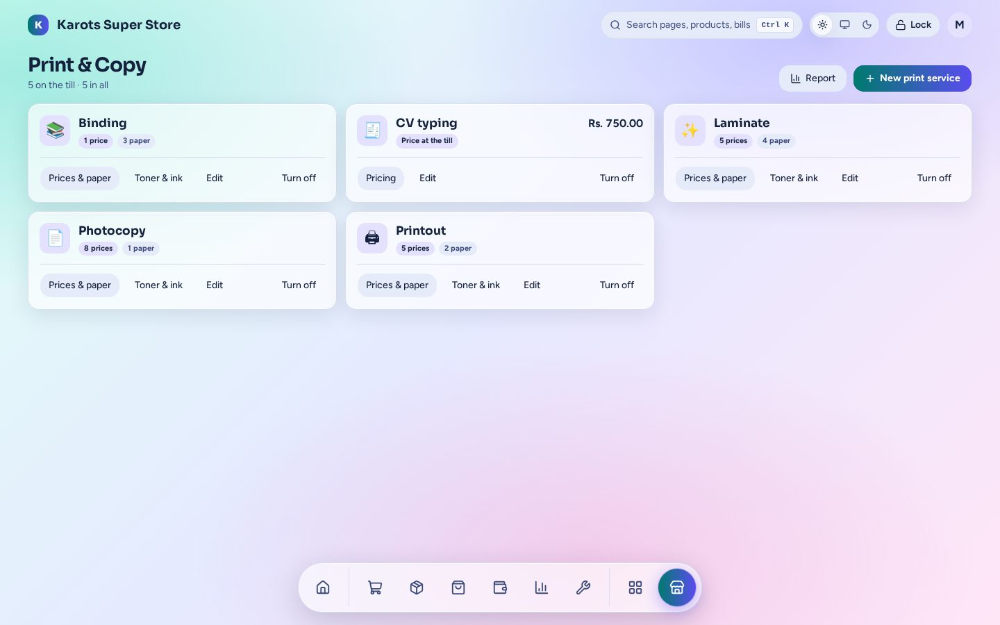

# Print & Copy

Photocopy, print, laminate and bind, for a shop with a copier.

- Each service has a **price grid by size × type × colour × side**, with quantity tiers for bulk prices.
- **Paper by size and type** comes off stock. Double-sided uses half the paper, and lamination uses a Gloss / Matte pouch.
- **Laminate and bind** are priced by size and type only.
- **Extras** such as Urgent or Hole punch can be added per job or per piece, and may take stock.
- A **job panel at the till** (it also opens from search and from a scan) builds the job. The job and its extras print on the receipt as one block, each line priced under the total.
- Custom-priced jobs, shop use, and mistaken jobs returned through core Returns. A **copies report** shows what was done.

The admin page is under **Apps → Print & Copy** (`/admin/x/documents`). A shop has this plugin only if it was built with it ([Install & Shop Builder](../install.md)).
