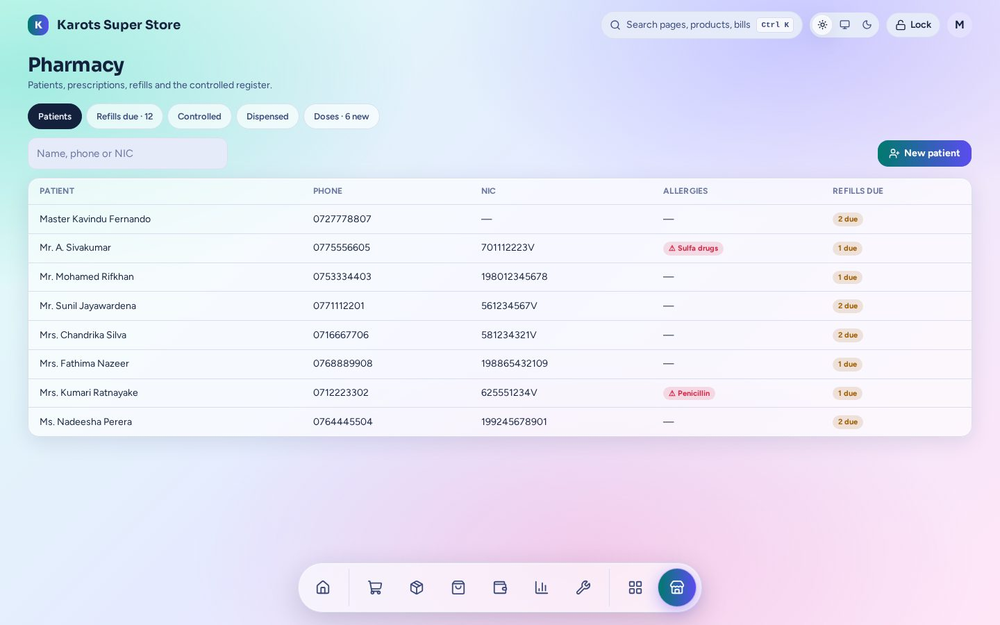

# Pharmacy

Patients, prescriptions and the controlled-drug register for a pharmacy. It comes with [Product Plus](productplus.md) and [Alternatives](alternatives.md).

- **Patients** are customers with allergies and a profile (NIC, phone).
- **Prescriptions** understand dose shorthand like `1-0-1` and work out how much to give.
- A **💊 Patient** panel at the till adds a script's medicines to the cart. The dispense is recorded from the sale itself, and a dose label can print.
- **Refills due:** a call list of patients whose medicine is about to run out.
- **Controlled-drug register:** read straight from stock movements, so it can't drift from the real stock.
- Medicines use core [packs](../stock.md#products) (a card of 10 sold whole or loose) and [batches](../stock.md#batches-and-expiry).

The admin page is under **Apps → Pharmacy** (`/admin/x/pharmacy`). A shop has this plugin only if it was built with it ([Install & Shop Builder](../install.md)).
