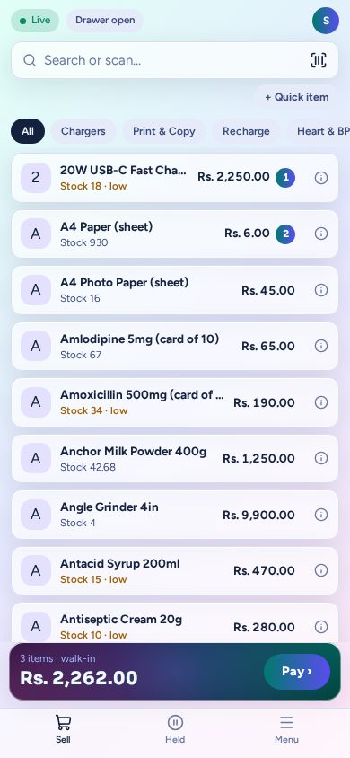

# Pocket Cashier app

A phone becomes a till on the shop's wifi. A cashier sells anywhere in the shop while the PC runs. When the PC or the
power is down, the phone keeps selling from its own copy of the shop, and the PC rings those sales up in order once it
is back.

## Set up a phone (once)

1. On the PC, open **Apps → Phones**. It shows a QR code for the setup page.
2. On the phone, on the shop wifi, point the camera at the code. The page shows the steps for that phone:
   - **Android**: download the shop certificate, then Settings → Security → Encryption & credentials → Install a
     certificate → **CA certificate**. Don't use the Wi-Fi certificate settings.
   - **iPhone**: in **Safari**, download the profile, install it in Settings, then Settings → General → About →
     **Certificate Trust Settings** → turn on "Karots Shop CA — your shop".
3. Once the phone trusts the shop, **Open the app** appears. Open it and add it to the home screen.
4. Give the phone a name. It shows a 6-digit code: in **Phones**, tap **Approve** on that phone, or **Approve by code**
   and type or scan it.

The shop's certificate is kept in the database, so a backup and restore keeps every phone working. The phones use
port 8443; Setup opens it in the PC's firewall.

## Selling

- **Sign in** with your name and PIN. Cashiers and managers can sign in even when the PC is down. An admin signs in
  only while the PC answers, and gets the normal admin pages.
- **Sell**: search, scan with the camera (or a Bluetooth scanner), or tap a category. Prices and packs work as at the
  till.
- **Pay**: cash (with the change to give), card, cheque or credit. While the PC answers, the receipt prints at the
  counter printer. If the shop asks before printing, the phone asks first. A phone never opens the cash drawer.
- **Held** keeps sales for later, the same held sales as the till.
- **Menu**: open the drawer, take cash out, put cash in, close the drawer, and switch person. The cash a phone takes
  is in that person's own drawer.

One person is on one device at a time. Signing in on the phone parks the cart that was on the PC in **Held**, and the
PC locks with "now on …".

## When the PC is down

The phone turns amber: "Selling from the copy of 09:31". It keeps selling, holding and moving cash. Stock shows as
"about", and nothing prints. Everything waits on the phone (encrypted) and goes to the PC the moment it is back.

The PC never refuses that work afterwards. It takes each sale in order and **flags** anything odd for a look:

- a price that changed meanwhile (the sale keeps the price the phone showed)
- stock sold that the count didn't have
- credit over the customer's limit
- a sale whose till was closed meanwhile (it counts when it arrived)
- a phone clock in the future
- a cashier who was turned off meanwhile

**Phones → What came in** lists every batch a phone sent, with each sale and its flags. A flagged sale opens in
**Sales**, which is also where a mistaken sale is returned.

## A lost or broken phone

- **Release** frees the person on it, so they can sign in elsewhere. Sales still on the phone are sent if it comes back.
- **Block** stops the phone at once. To use it again, **Remove** it and pair it again.

A shop has this app only if it was built with it ([Install & Shop Builder](../install.md)).
