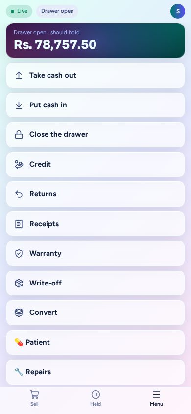

# Pocket Cashier app

A phone or tablet as the shop's backup till. The PC or laptop stays the normal till. The phone is for two moments: going
portable while the PC is on (walking with a customer), and keeping the shop off pen and paper when the PC or the power is
down. Leave it on a charger with the app open: it keeps its copy of the shop up to date with nobody signed in. When the PC
comes back, it takes everything the phone did, in order.

## Set up a phone (once)

1. On the PC, open **Apps → Phones**. It shows a QR code for the setup page.
2. On the phone, on the shop wifi, point the camera at the code. The page shows the steps for that phone:
   - **Android**: download the shop certificate, then Settings → Security → Encryption & credentials → Install a
     certificate → **CA certificate**. Don't use the Wi-Fi certificate settings.
   - **iPhone**: in **Safari**, download the profile, install it in Settings, then Settings → General → About →
     **Certificate Trust Settings** → turn on "Karots Shop CA — your shop".
3. Once the phone trusts the shop, **Open the app** appears. Open it and add it to the home screen.
4. Give the phone a name. It shows a 6-digit code: in **Phones**, tap **Approve** on that phone, or **Approve by code**
   and type or scan it. A phone waiting for approval also shows on the dashboard under **Needs your attention**.

The shop's certificate is kept in the database, so a backup and restore keeps every phone working. The phones use
port 8443; Setup opens it in the PC's firewall.

## Selling

- **Sign in** with your name and PIN. Cashiers and managers can sign in even when the PC is down. An admin signs in
  only while the PC answers, and gets the normal admin pages.
- **Sell**: search, scan with the camera (or a Bluetooth scanner), or tap a category. The phone sells as the till
  does, laid out for one hand:
  - **Which price?** when a product's lots are at different prices (or the one that would sell is expired), and
    **loose or by the pack** for a product sold by the pack (a pack's own barcode adds the pack).
  - Tap a cart line for its **quantity** on a keypad (a weight like 1.25 kg where the unit allows it), its
    **discount** (an amount off each, or %), its **serial numbers**, or Remove.
  - The open cart has the **bill discount** and **Retail / Wholesale**. ⓘ on a product shows what the till knows.
  - **+ Quick item** (beside the search, and when a search finds nothing) sells something not in the catalogue
    yet; the camera can read its barcode. A scanned barcode no product has asks, as the till does: **Existing
    item** (give the code to the item it belongs to) or **New item**. Both need the PC: an admin finishes a quick
    item later.

- **Plugins**: whatever the shop has works here too, with the same screens as the till, online and off.
  - **Reload & Bills**, **Print & Copy** and **Combos** are buttons above the categories. Tapping a product one of them owns opens its screen.
  - **Patient** (Pharmacy) and **Repairs** are on the Menu. A scanned repair ticket opens its job.
  - **Alternatives** shows on an out-of-stock cart line, as a swap.
  - Something made offline has a temporary number (a repair shows `New-xxxx`) until the PC gives it the real one.
- **Pay**: cash, card, **online** (into a bank account), cheque, on account, and plugin payments — **several on one
  sale** (Add payment, remove one with ×). For cash, tap the **notes and coins** the customer hands over (or switch to
  the keypad, or tap a quick amount); the change to give is shown **note by note**, and the cashier can **keep the
  coins** (or put what's kept on the customer's account). Pick a customer to see their balance and limit; **+ New
  customer** adds one while the PC answers. Over the limit, the sale still goes and is flagged. While the PC answers,
  the receipt prints at the counter printer. If the shop asks before printing, the phone asks first. A phone never
  opens the cash drawer.
- **Held** keeps sales for later, the same held sales as the till.
- **Menu**: open the drawer, take cash out, put cash in, close the drawer, and switch person. The cash a phone takes
  is in that person's own drawer.
- **Tickets** from a sales person show above the screen, with a beep, while the PC answers. Tap one to open it; closing the
  drawer deals with what's waiting first, as on the PC. Sales people can't use the phone themselves.

## The counter on the phone

On the Menu, online and off:

- **Credit**: take a payment or an advance from a customer, or refund one.
- **Returns**: find a sale from the last 30 days by receipt, customer or product, take items back, refund.
- **Receipts**: the sales of the last 30 days and what waits on this phone. The cash, credit and warranty slips, and any
  reprint, need the PC.
- **Warranty**: find a unit by serial or receipt and swap it.
- **Write-off** and **Convert**: take stock out, or break open a pack.

Labels, Suppliers, Expenses, Low stock and Customer requests stay on the PC.

The phone keeps the last 30 days of sales, and every product, customer and patient. An older sale needs the PC: online the
phone asks it; offline, ask the customer to come back when it's on.

One person is on one device at a time. Signing in on the phone parks the cart that was on the PC in **Held**, and the
PC locks with "now on …". It works the other way too: signing in on a PC signs the phone out, its cart waiting in
**Held**.

## When the PC is down

The phone notices within about 20 seconds and turns amber: "Selling from the copy of 09:31". Everything above keeps
working from the phone's own copy. Stock and balances are as of the last sync, plus what this phone has done since, and
nothing prints: print receipts, dose labels and repair slips from the PC afterwards. Everything waits on the phone
(encrypted) and goes to the PC the moment it is back.

Two phones during a cut don't see each other's work until the PC is back. A sale made during the cut can't be returned on
the phone until the PC has it.

The PC never refuses that work afterwards. It takes each sale in order and **flags** anything odd for a look:

- a price that changed meanwhile (the sale keeps the price the phone showed)
- stock sold that the count didn't have
- credit over the customer's limit
- a serial number already sold, given twice, or missing
- a sale whose till was closed meanwhile (it counts when it arrived)
- a phone clock in the future
- a cashier who was turned off meanwhile
- a credit payment taken against an out-of-date balance
- anything that happened on the phone a while before it arrived (it shows when; it counts on the day it arrives)

A very few things the PC really can't take, such as goods already returned on the PC, or a repair already collected. The
stock and the records don't change, but cash that left or entered the drawer is still booked, and the note says so. If the
till was closed by then, one is opened for it and marked for review, as for a late sale. What depended on a refused item is
refused too, and names it. While the PC answers, the cashier sees a refusal on the spot and no money moves.

If the PC itself has trouble (a restart during an update), the phone just tries again, for a few minutes, before it counts
as refused.

**Phones → What came in** lists every batch a phone sent, with each action and its flags. A flagged sale opens in
**Sales**, which is also where a mistaken sale is returned.

A reload past the float isn't flagged: as at the till, it goes through and the float shows red on the Reload page, asking
for a count.

**One person, one device:** whichever sign-in came last holds them. Someone who signed in on the phone during a cut stays
on it when the PC is back; someone who has gone back to the PC stays there.

## A lost or broken phone

- **Release** frees the person on it, so they can sign in elsewhere. Sales still on the phone are sent if it comes back.
- **Block** stops the phone at once. To use it again, **Remove** it and pair it again.
- **Remove** takes any phone off the list, one in use too (a replaced phone). Sales still waiting on it never arrive,
  so block a phone that may come back instead.

A shop has this app only if it was built with it ([Install & Shop Builder](../install.md)).
