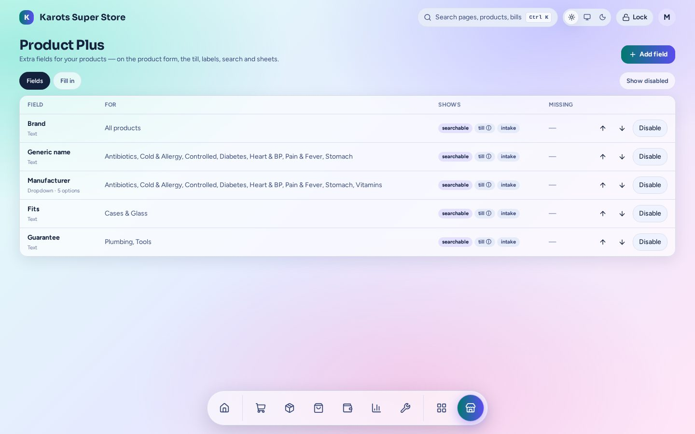
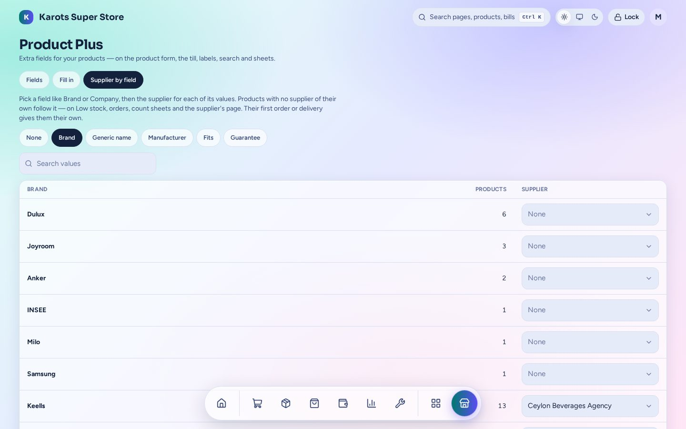

# Product Plus

Extra product fields for the things your shop cares about: brand, generic name, manufacturer, guarantee, fits…

- Field kinds: **text, number, yes / no, dropdown, date**. A field covers all products or chosen categories.
- Fields show on the product form, stock intake, the till's ⓘ info, labels, search and the product list.
- **Fill in** a field across many products at once and see which are missing a required one.
- Fields travel in product sheets behind a toggle.
- **Moving a product to another category:** values of fields that no longer apply are kept but hidden, and come back if it moves back. The new category's fields start empty; if one is required, the product form asks for it on the next save, and Fill in shows what's missing.
- **Supplier by field** (for putting a shop's products in): pick one text or dropdown field, such as Brand or
  Company, and set a supplier for each of its values. A product with no supplier of its own then counts as that
  supplier's on Low stock and the orders made from it, stock-take and count sheets, the products list's supplier
  filter, the supplier's page ("12 products + 30 by rule") and smart reorder levels. The product form shows it under
  Preferred supplier ("British Agencies by Company: Cipla Limited"). Its first order or delivery gives the product its
  own supplier, which always wins, so the rule fades out as the shop trades. Values match whatever the case or spaces
  ("bosch" = "Bosch "); the list shows values with no supplier first, then the most used. Loss claims, a lot's
  supplier and product sheet exports only ever use a product's own supplier. Choosing another field clears the
  suppliers set for the old one (you're asked first); moving a supplier's products to another moves its rules too.

  
- With [AI Assistant](aicatalog.md), **Fill in details** fills the fields you tick, per category, reusing values you already use. A product that moved category comes back on that list for its new fields.

The admin page is under **Apps → Product Plus** (`/admin/x/productplus`). A shop has this plugin only if it was built with it ([Install & Shop Builder](../install.md)).
