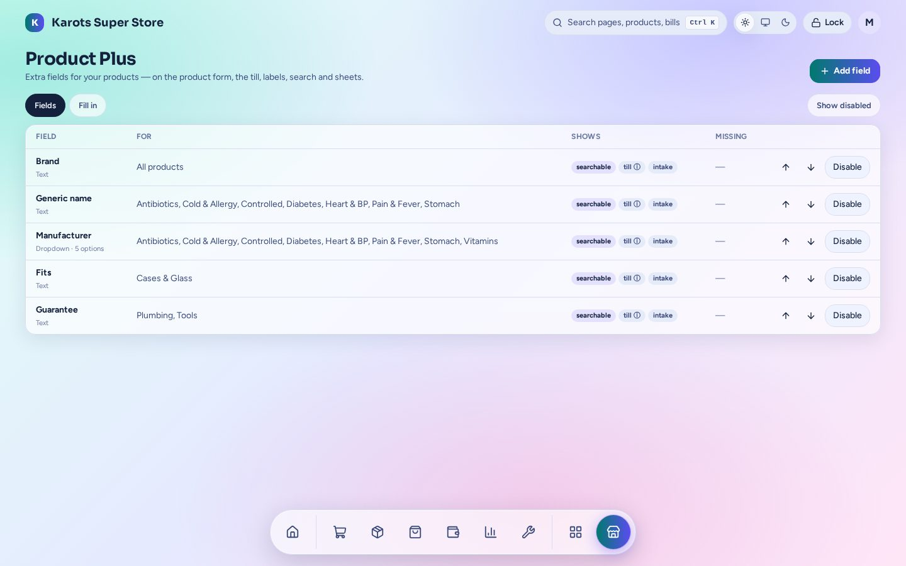

# Product Plus

Extra product fields for the things your shop cares about: brand, generic name, manufacturer, guarantee, fits…

- Field kinds: **text, number, yes / no, dropdown, date**. A field covers all products or chosen categories.
- Fields show on the product form, stock intake, the till's ⓘ info, labels, search and the product list.
- **Fill in** a field across many products at once and see which are missing a required one.
- Fields travel in product sheets behind a toggle.
- **Moving a product to another category:** values of fields that no longer apply are kept but hidden, and come back if it moves back. The new category's fields start empty; if one is required, the product form asks for it on the next save, and Fill in shows what's missing.
- With [AI Assistant](aicatalog.md), **Fill in details** fills the fields you tick, per category, reusing values you already use. A product that moved category comes back on that list for its new fields.

The admin page is under **Apps → Product Plus** (`/admin/x/productplus`). A shop has this plugin only if it was built with it ([Install & Shop Builder](../install.md)).
