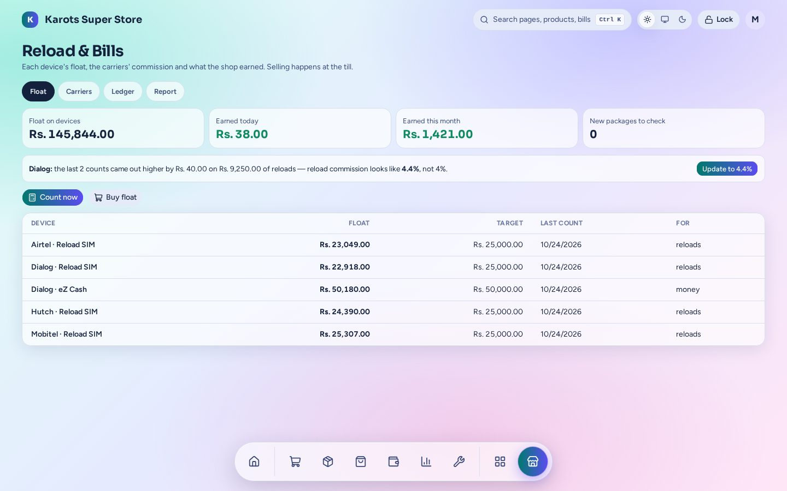

# Reload & Bills

For a shop that is a mobile-money agent: reloads, carrier packages, bill payments, wallet deposits and cash outs.

- Every reload, package, bill or cash out is a **cart line** paid through the normal Pay: cash, card, split, credit, with a receipt. A cash out is money given to the customer, so a sale can total below zero.
- **One running float per device** (an Airtel reload SIM, a Dialog eZ Cash account…). The page shows each float, its target and when it was last counted.
- The carrier's **commission is booked as it happens**. **Earned today / this month** and the **Ledger** show it, and when float counts show the carrier paid a different rate than the one you set, the page says so and offers to update it.
- Count the float at open and close if you want to (it's optional), **Buy float** from a dealer (a normal supplier) — paid now, by cheque or on credit; a bounced cheque leaves the dealer owed again and the float stays — and let any sale be paid from a wallet as a tender.

The admin page is under **Apps → Reload & Bills** (`/admin/x/recharge`). A shop has this plugin only if it was built with it ([Install & Shop Builder](../install.md)).
