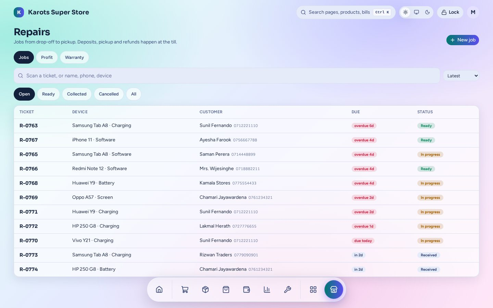

# Repairs

Repair jobs from drop-off to pickup.

- A **job**: device, fault, parts and labour, promised date and warranty. Print a ticket label and a slip for the customer.
- **Deposits** are the customer's advance. **Pickup** goes through the normal till and Pay, so a repair's money is in the same reports as everything else.
- The outside repairer is paid as an **expense** tagged to the repair (cash or cheque), so **Profit** per job is right. If that cheque bounces, the job shows the repairer as not paid again.
- Jobs move through **Received → In progress → Ready → Collected** (or Cancelled). Overdue jobs stand out.
- **Warranty**: a job that comes back under its warranty is tracked.

The admin page is under **Apps → Repairs** (`/admin/x/repairs`). A shop has this plugin only if it was built with it ([Install & Shop Builder](../install.md)).
