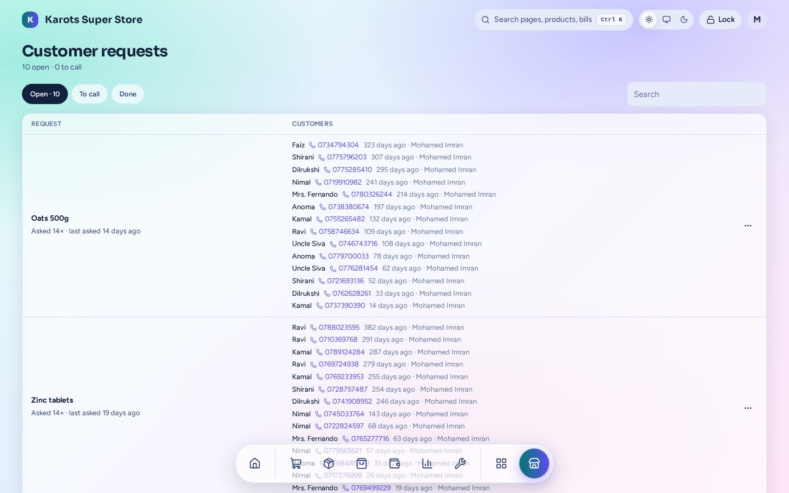

# Customer requests

Remember what customers ask for that the shop doesn't carry.

- Cashiers note the item and the customer's phone. Repeat requests add up instead of making duplicates.
- Admin **makes a product**, **links** an existing one, or marks it **won't stock**.
- Once the item is in stock, the list says **whom to call**.

The admin page is under **Apps → Customer requests** (`/admin/x/requests`). A shop has this plugin only if it was built with it ([Install & Shop Builder](../install.md)).
