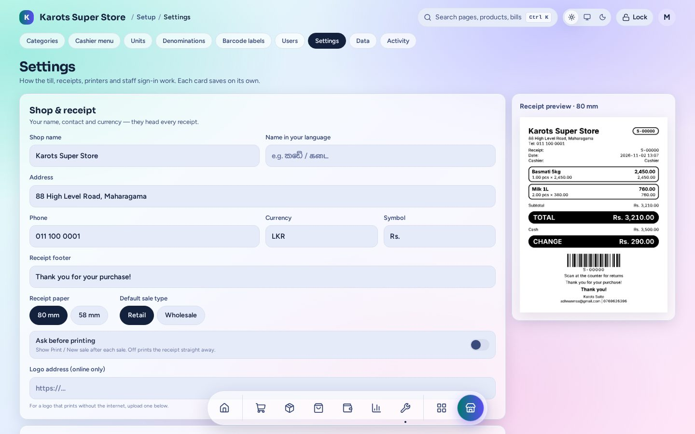
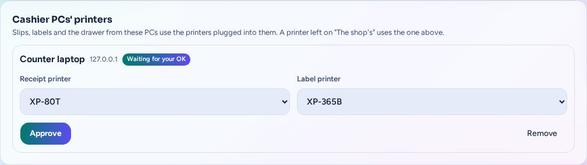
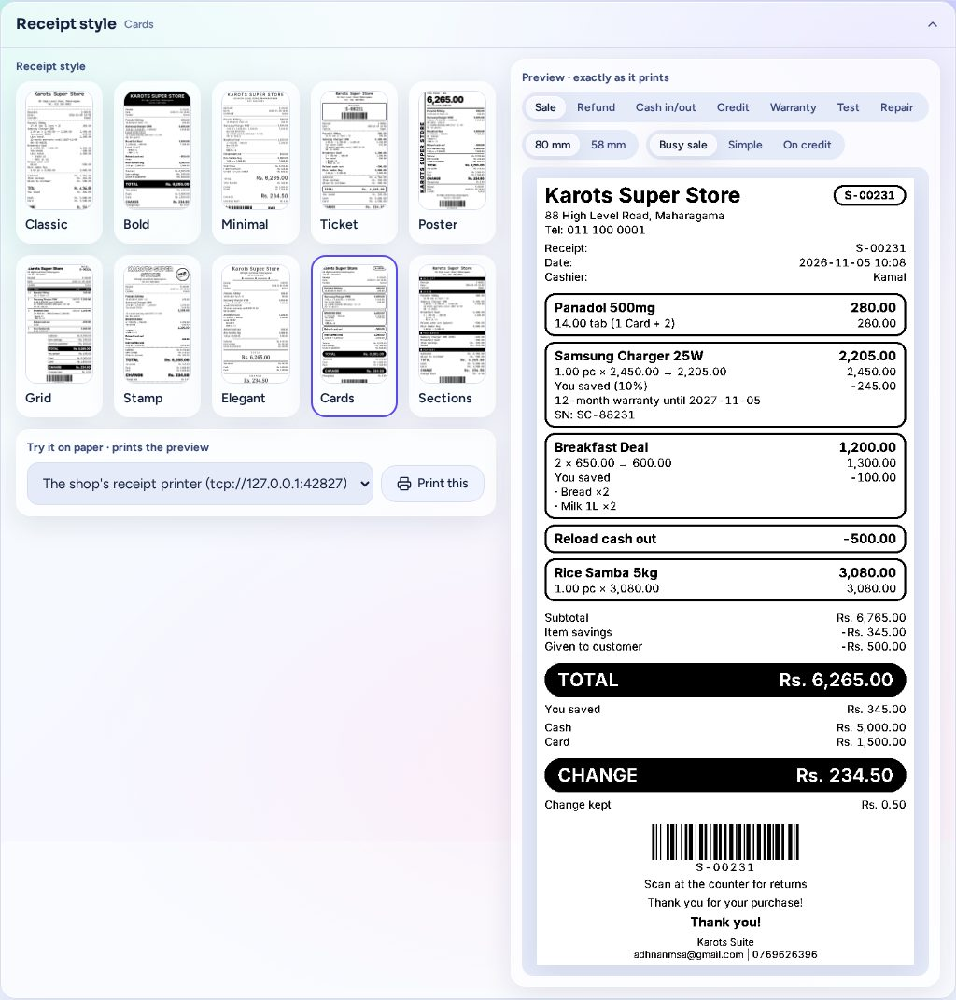
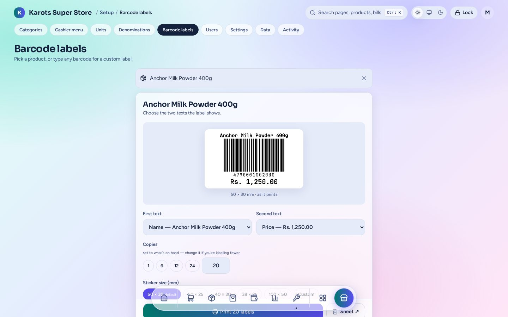
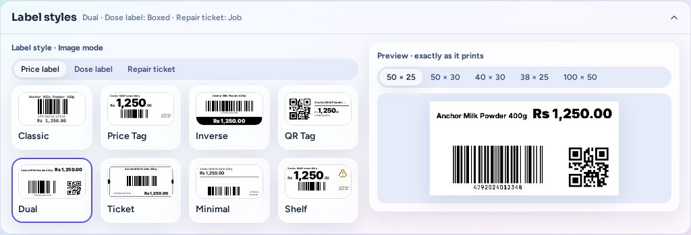

# Printing

Receipts and labels print straight from the shop's server to thermal printers (80 mm or 58 mm
receipts and barcode label printers), so no print dialog pops up at the till. Invoices, POs,
GRNs, statements, Z reports and count sheets are A4 pages you print or save as PDF from the
browser.

## Receipt settings

In **Setup → Settings**:

- **Shop & receipt:** the shop name (also in your own language), address, phone, currency,
  receipt footer, paper width (80 or 58 mm), the default sale type, and a logo. A live preview
  sits beside it.
- **Ask before printing:** shows **Print / New sale** after each sale. With it off, the receipt
  prints straight away. Every slip follows this setting: sales, refunds, cash in / out, credit,
  warranty, reprints and plugin slips.
- **How a receipt prints:** as a picture in the shop's receipt style, so Sinhala and Tamil print exactly
  as they look on screen. If a picture ever can't be drawn, that one slip prints as plain text, so a
  customer still gets a receipt.
- Each user can have their own receipt printer (Users page).
- **A printer plugged into a cashier PC:** see below.

## Printers we've tested

- **Xprinter XP-80T** (receipts, USB; it shows up as `POS-80`): all ten receipt
  styles, on the PC itself and from a cashier PC, on Linux; Windows 10 with the built-in **Generic / Text
  Only** driver prints its test slips.

## Printers on a cashier PC

Setup puts a small print helper on every cashier PC. It tells the main PC which printers that PC
has and prints what it is sent, so a USB receipt printer can sit at the counter. On Linux, Setup
also makes a queue for each USB printer plugged in at the time; plug one in later and run
**Setup → Update** on that PC. On Windows, install the printer so it shows in Windows first.

1. In **Settings → Cashier PCs' printers**, the PC shows as **Waiting for your OK**.
2. Pick its receipt and label printers, then press **Approve**. **Test slip** checks it.

From then on, slips, labels and the drawer from that PC use its printers, ahead of a person's own
printer on the Users page. A printer left on **The shop's** uses the main one. If the PC is off,
printing there fails the way any printer that is off does; the sale itself still stands.

## Receipt styles

A receipt uses one of ten styles: **Classic, Bold, Minimal, Ticket, Poster, Grid,
Stamp, Elegant, Cards** and **Sections**. The preview shows each kind of slip (sale, refund, cash
in / out, credit, warranty, test, and plugin slips such as repairs) at 80 and 58 mm, exactly as it
prints. The style is set for the whole shop when the suite is set up; ask your Karots technician
to change it. Under the preview, the technician can pick any printer (this PC's, a cashier PC's, or a network
printer by its address) and press **Print this** to see that slip on paper before saving a style. It
only tries that printer, so Settings stays as it is. It prints the sample only: no sale and no drawer.

## Labels

**Setup → Barcode labels** (and the till's Labels tab) prints labels for a product, or a custom
label with any barcode and text.

- Pick the first and second text (name, price, a product field…).
- Set the copies. By default this is the stock you have on hand.
- Pick a sticker size: 50 × 30, 50 × 25, 40 × 30, 38 × 25, 100 × 50 or your own.
- **Sheet ↗** prints the same labels on an A4 sheet instead.

Intake can print labels as it saves new stock.

Labels have styles too. Price labels come in **Classic, Price Tag, Inverse, QR Tag, Dual,
Ticket, Minimal** and **Shelf**, and plugins add their own label kinds (Pharmacy's dose label,
Repairs' ticket). **Print labels as Image / Classic** sets how labels print, and the preview has the same
printer choice and **Print this**, which prints one label.

## Drawer

The cash drawer is plugged into the receipt printer. It opens on cash events (a cash sale, a
deposit or withdrawal) and for no-sale. It stays shut for card-only sales.
