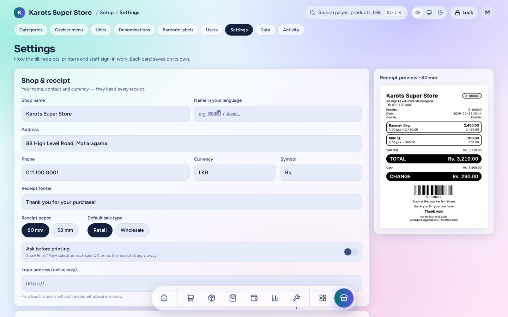
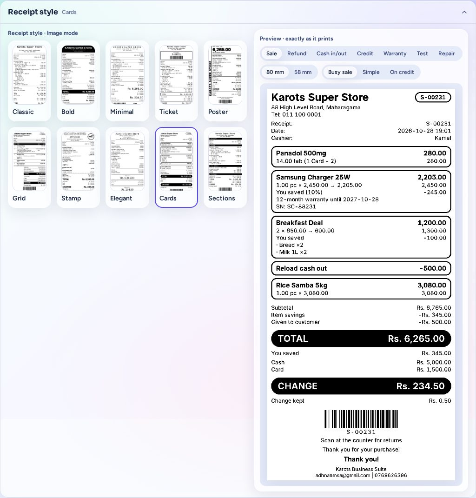
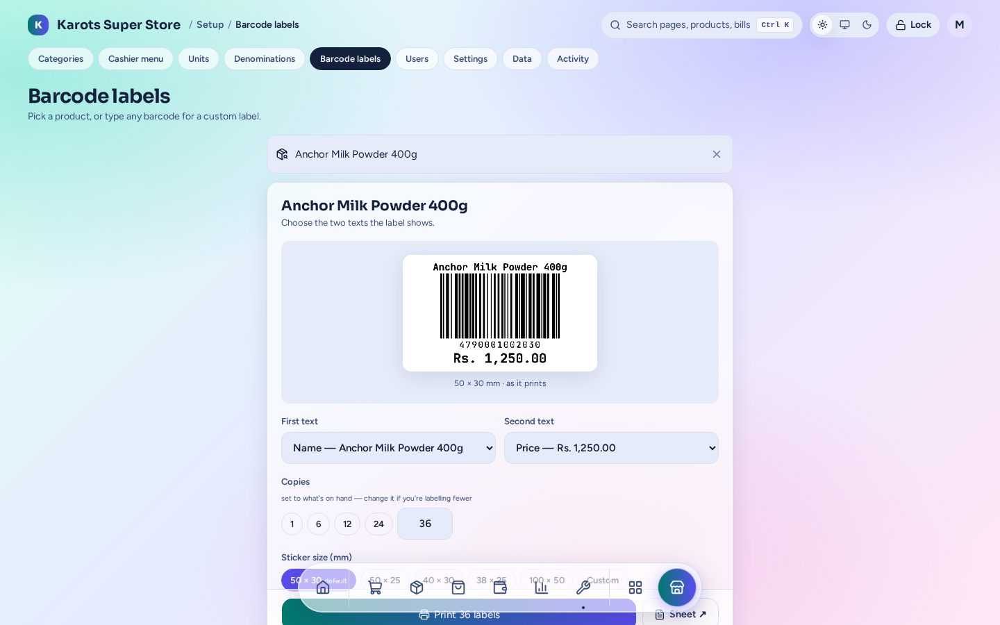
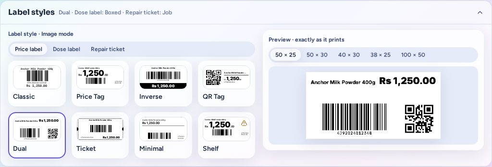

# Printing

Receipts and labels print straight from the shop's server to thermal printers (80 mm or 58 mm
receipts and barcode label printers), so no print dialog pops up at the till. Invoices, POs,
GRNs, statements, Z reports and count sheets are A4 pages you print or save as PDF from the
browser.

## Receipt settings

In **Setup → Settings**:

- **Shop & receipt:** the shop name (also in your own language), address, phone, currency,
  receipt footer, paper width (80 or 58 mm), the default sale type, and a logo. A live preview
  sits beside it.
- **Ask before printing:** shows **Print / New sale** after each sale. With it off, the receipt
  prints straight away. Every slip follows this setting: sales, refunds, cash in / out, credit,
  warranty, reprints and plugin slips.
- **Printers & labels → Print receipts as:**
  - **Image:** the slip is drawn as a picture in the shop's receipt style, so Sinhala and Tamil
    print exactly as they look on screen.
  - **Classic:** the printer's own text font.
- Each user can have their own receipt printer (Users page).

## Receipt styles

In Image mode a receipt uses one of ten styles: **Classic, Bold, Minimal, Ticket, Poster, Grid,
Stamp, Elegant, Cards** and **Sections**. The preview shows each kind of slip (sale, refund, cash
in / out, credit, warranty, test, and plugin slips such as repairs) at 80 and 58 mm, exactly as it
prints. The style is set for the whole shop when the suite is set up; ask your Karots technician
to change it.

## Labels

**Setup → Barcode labels** (and the till's Labels tab) prints labels for a product, or a custom
label with any barcode and text.

- Pick the first and second text (name, price, a product field…).
- Set the copies. By default this is the stock you have on hand.
- Pick a sticker size: 50 × 30, 50 × 25, 40 × 30, 38 × 25, 100 × 50 or your own.
- **Sheet ↗** prints the same labels on an A4 sheet instead.

Intake can print labels as it saves new stock.

Labels have styles too. Price labels come in **Classic, Price Tag, Inverse, QR Tag, Dual,
Ticket, Minimal** and **Shelf**, and plugins add their own label kinds (Pharmacy's dose label,
Repairs' ticket). **Print labels as Image / Classic** works like the receipt setting.

## Drawer

The cash drawer is plugged into the receipt printer. It opens on cash events (a cash sale, a
deposit or withdrawal) and for no-sale. It stays shut for card-only sales.
