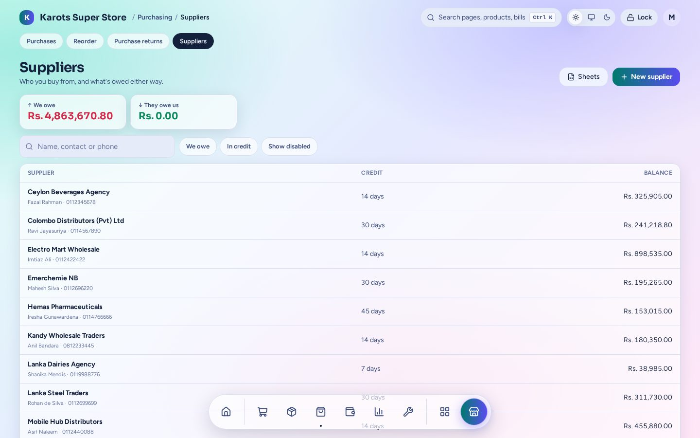
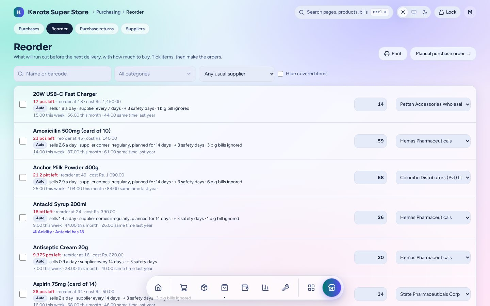
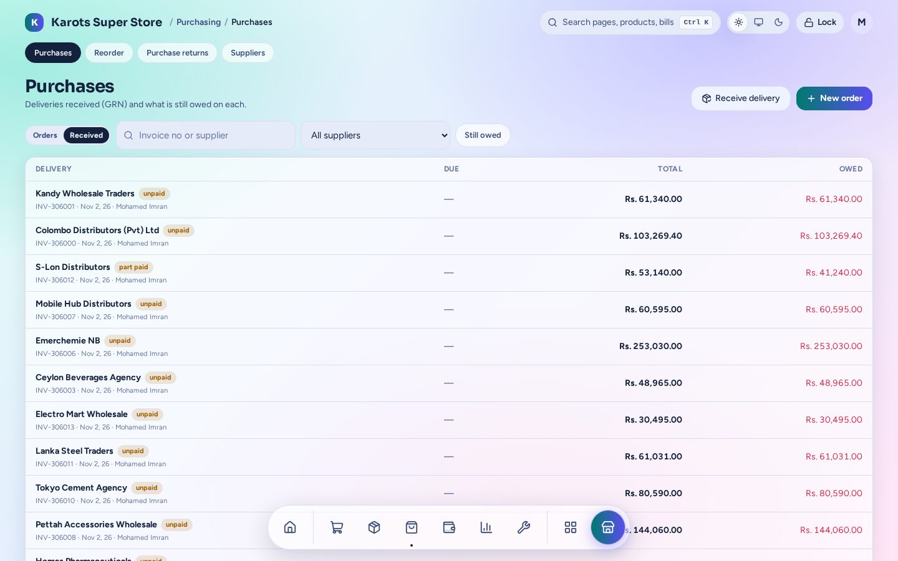
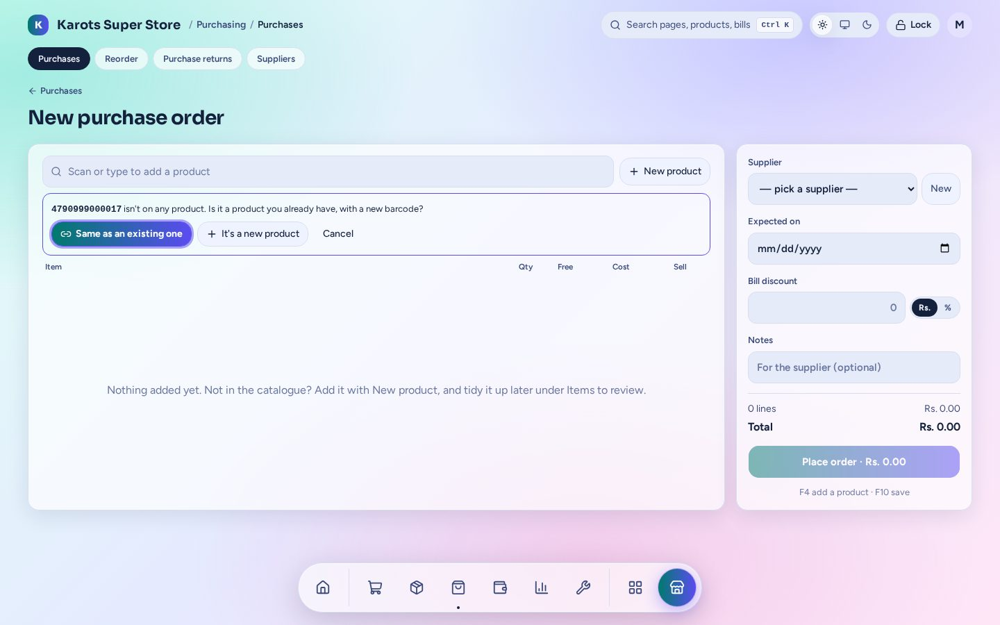
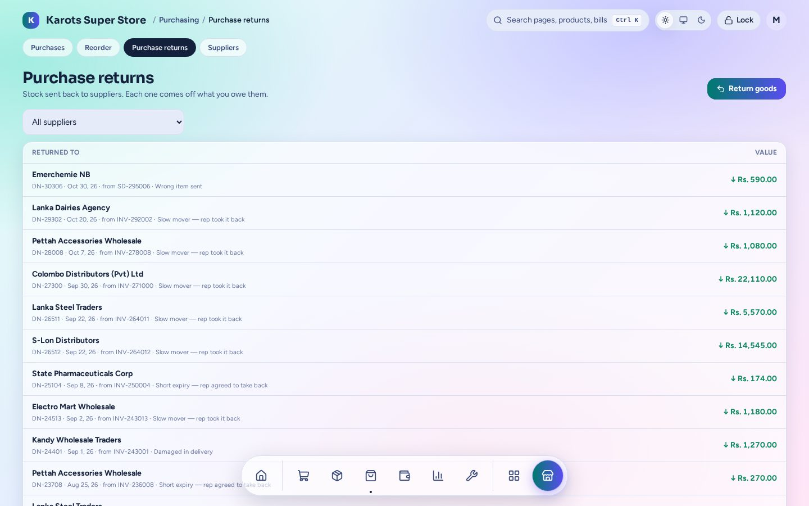

# Purchasing

Suppliers, what you order from them, what arrives and what goes back. You'll find it under
**Purchasing**.

## Suppliers

The top of the page shows what you owe all suppliers and what they owe you. Each supplier has
credit days, a running balance and a statement you can print. **Pay** a supplier against chosen
bills, against an old debt, or split across them, from a locker or the till. An old balance from
before the suite can be entered as an opening balance.

If a supplier takes something off when you pay, pay what you agreed, then press **Pay** again with the
rest and choose **Discount**. The bill closes and no money moves. It shows on their statement, and as
a gain in the profit report. A discount given at delivery goes on the delivery itself.

A supplier who must be told about expiring stock in good time gets their own **Warn before expiry**
number on their form; see [Batches and expiry](stock.md#batches-and-expiry).

## Reorder

Everything that will run out before its supplier comes again, with how much to buy. The
quantities come from the [smart reorder levels](stock.md#smart-reorder-levels). Tick the items,
check the suppliers and make the orders: one purchase order per supplier. **Print** gives a
paper list to take round.

## Purchase orders and receiving

- **New order:** pick a supplier and add lines, or build the order from Reorder. Print or save
  the PO.
- **Receive delivery:** tick off what came. Short, extra or forgotten items are handled, and the
  rest of the order can stay open. A **margin guard** warns when a new cost leaves too little
  margin at the current price. Receiving prints a **GRN**.
- Pay now or leave it on credit. The **Received** tab shows each delivery and what's still owed
  on it.

### A product that isn't in the catalogue

**+ New product** beside the search box adds one by name, with its cost and selling price, and it joins the
delivery straight away. It waits on **Items to review** for its real category and details.

A scanned barcode no product has asks first, since a new batch often carries a new barcode: **Same as an
existing one** adds the code to that product, or choose **It's a new product**.

## Returns to suppliers

Send stock back against a delivery: short expiry, slow movers, damage. Each return takes the
stock off and comes off what you owe that supplier.

## Giving a batch back

When a supplier takes a batch back, or you want to give it to them, and you'll settle it later:

1. **From this supplier**, on the supplier's page, lists their expired batches and those close to
   expiry. Press **Told them** to keep the date you told them. It's only a record.
2. Press **Give back**, here or on **Inventory → Batches**, and type what you counted on the shelf.
   All of it goes back.
3. It then waits on that supplier as "given back". Press **Settle** when they replace it or pay for
   it, in full or part. Until then it counts as a loss in reports, like any write-off.

**If they replace it with a different product,** settle it as **Credited us** with what it was worth,
then enter what they bring as a normal delivery. A credit goes on their open bills, oldest first, and
what's left pays their next delivery. If they brought less, the difference stays as what they owe you.

Batches get mixed on the shelf, so the count wins. If it's more than the system says, the extra
comes from the product's other batches. If it's less, the rest moves onto its next batch. Only when
there's no other batch to take it does the stock total change, as an adjustment in **Movements**.
Any other mix-up shows at the next stock-take. Units that move between batches of different cost
blend into that batch's cost, so the value of your stock stays right.

A batch with no supplier can't be given back or recalled until its product has a preferred supplier.

## When a supplier recalls a batch

Press **Recall** on the batch, on **Inventory → Batches** or on the supplier's panel, and choose:

- **Keep selling** if it isn't really bad. Nothing changes at the counter.
- **Stop selling** if it is. The till and the phone warn the cashier when it's next to sell or picked,
  as for an expired batch, and they can go back or sell anyway. The dashboard shows it until it's gone.

The batch stays in stock and on the supplier's panel, however long the rep takes. Collect it off the
shelf, then **Give back** what's left when they come. What was sold before that isn't part of the
claim. **Undo recall** puts it back to normal if the supplier changes their mind.
