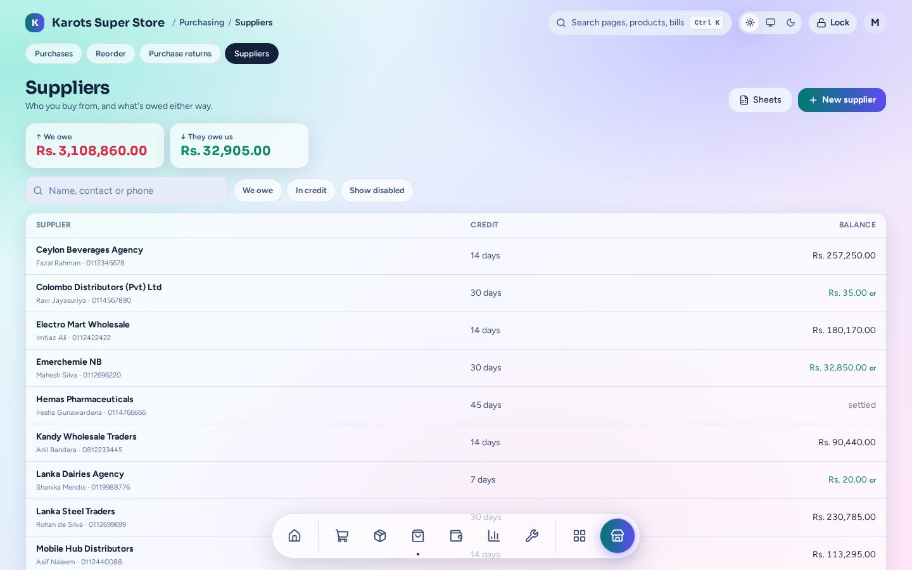
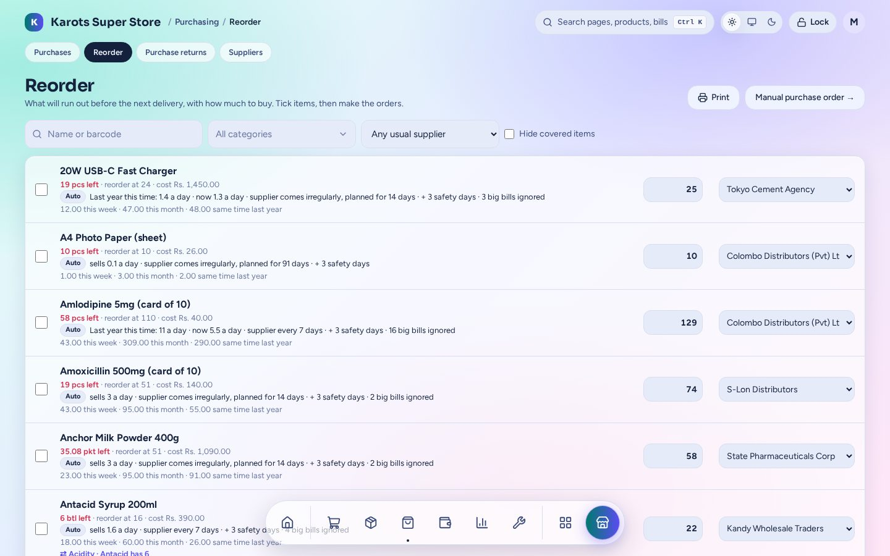
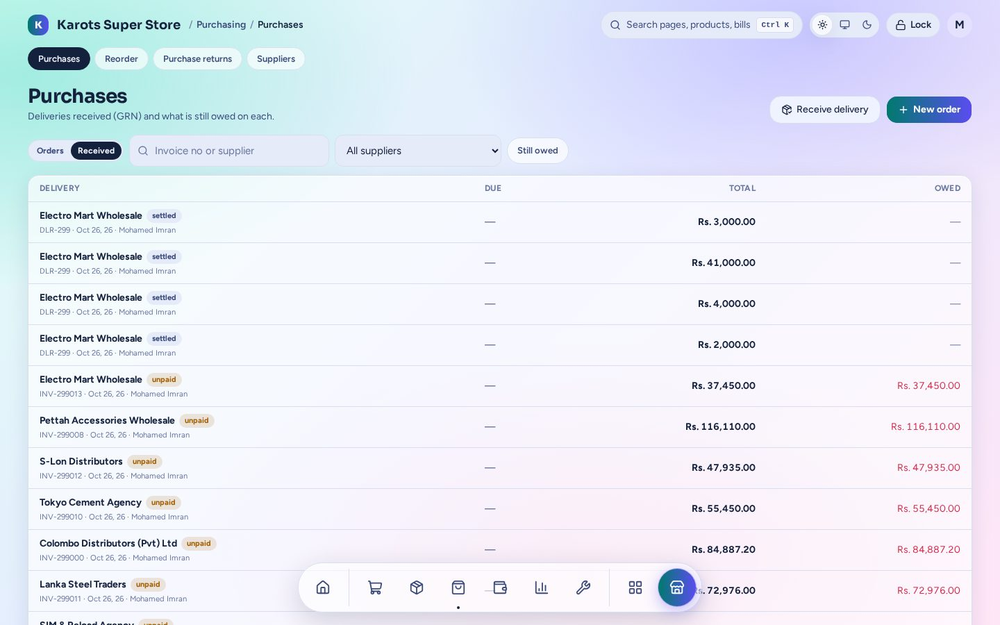
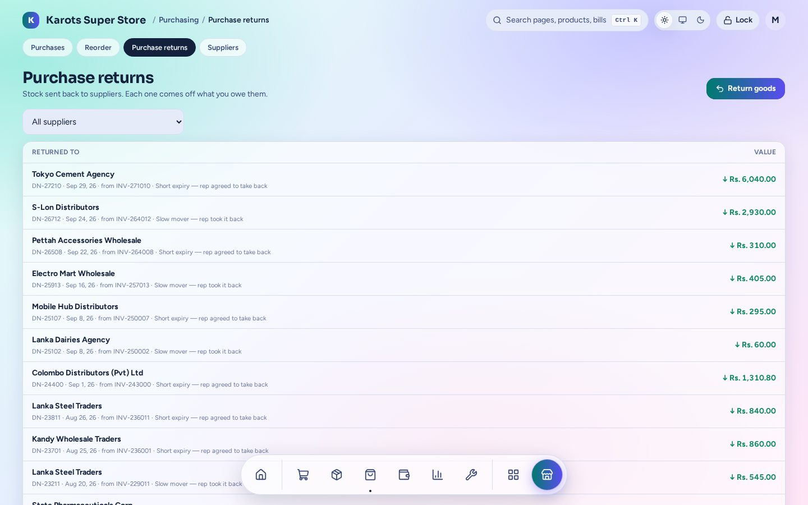

# Purchasing

Suppliers, what you order from them, what arrives and what goes back. You'll find it under
**Purchasing**.

## Suppliers

The top of the page shows what you owe all suppliers and what they owe you. Each supplier has
credit days, a running balance and a statement you can print. **Pay** a supplier against chosen
bills, against an old debt, or split across them, from a locker or the till. An old balance from
before the suite can be entered as an opening balance.

## Reorder

Everything that will run out before its supplier comes again, with how much to buy. The
quantities come from the [smart reorder levels](stock.md#smart-reorder-levels). Tick the items,
check the suppliers and make the orders: one purchase order per supplier. **Print** gives a
paper list to take round.

## Purchase orders and receiving

- **New order:** pick a supplier and add lines, or build the order from Reorder. Print or save
  the PO.
- **Receive delivery:** tick off what came. Short, extra or forgotten items are handled, and the
  rest of the order can stay open. A **margin guard** warns when a new cost leaves too little
  margin at the current price. Receiving prints a **GRN**.
- Pay now or leave it on credit. The **Received** tab shows each delivery and what's still owed
  on it.

## Returns to suppliers

Send stock back against a delivery: short expiry, slow movers, damage. Each return takes the
stock off and comes off what you owe that supplier.
