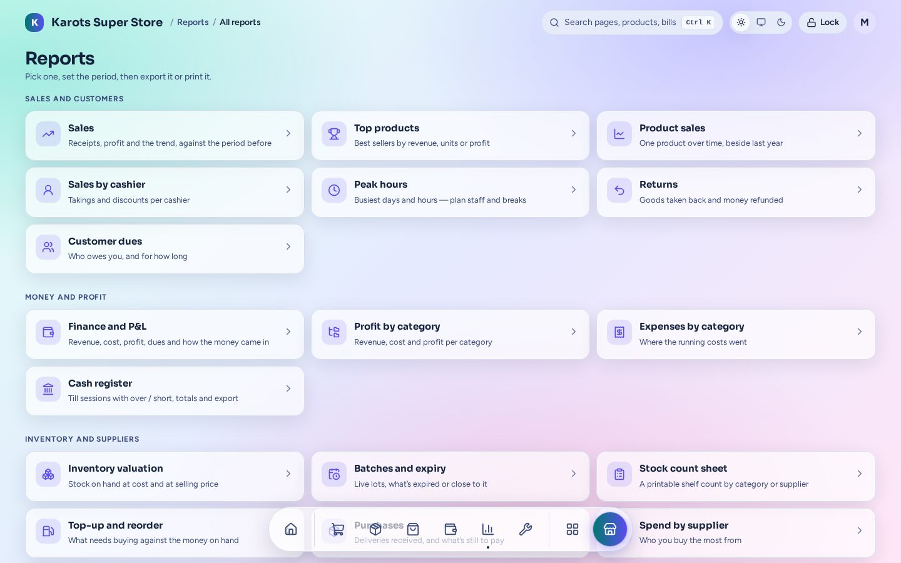
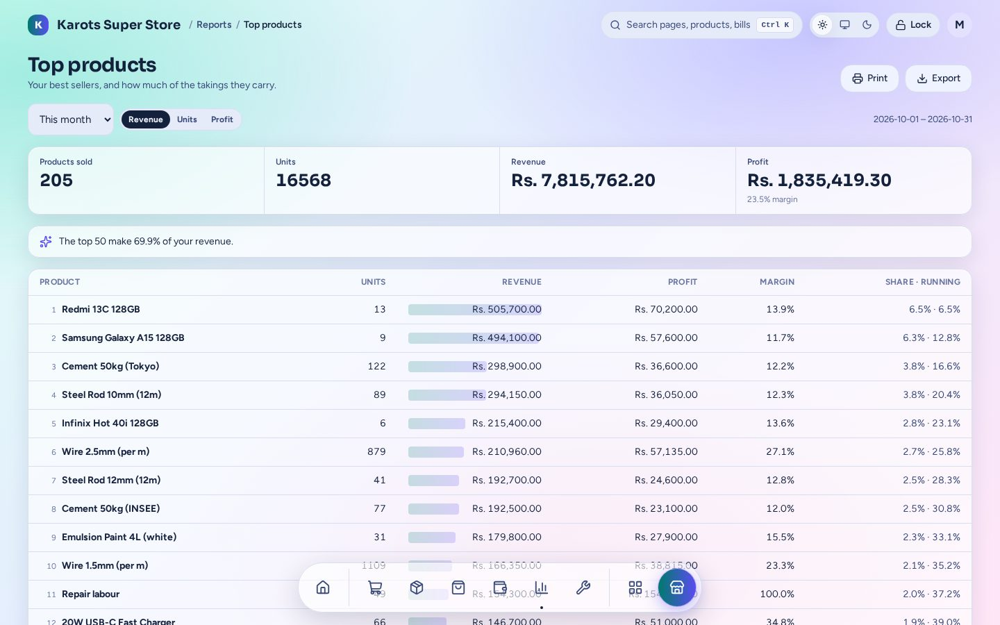
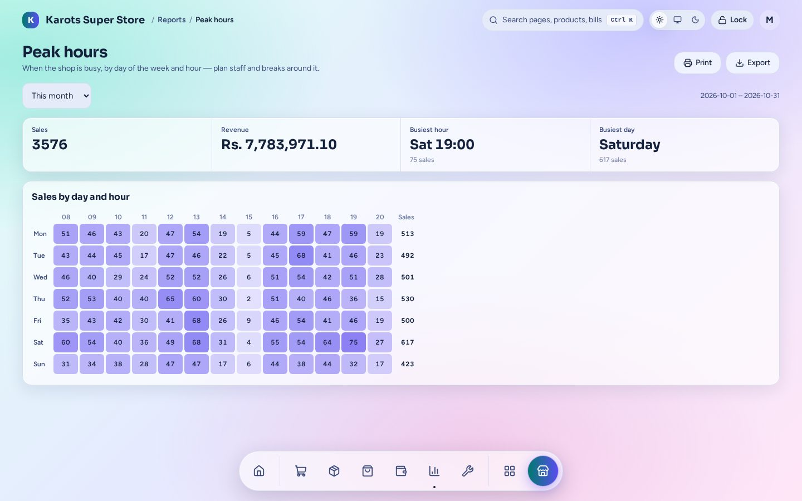
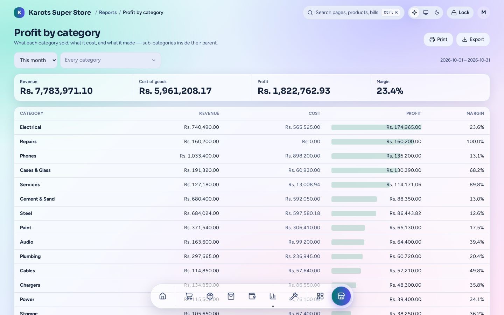
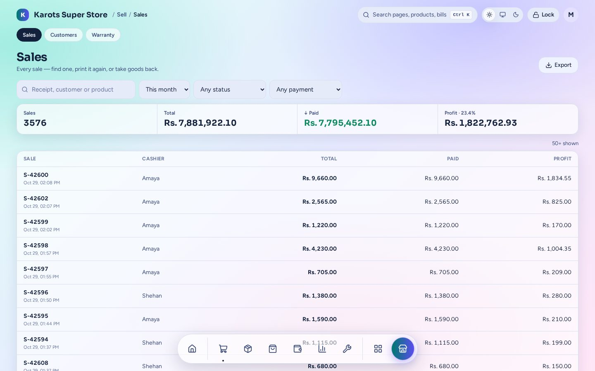
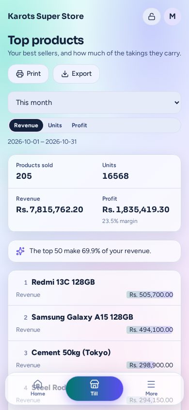

# Reports & dashboard

## Dashboard

The first page after sign-in. It shows:

- **Sales today**, **gross profit**, **cash in the tills** and **owed to you**, each against
  yesterday.
- **Sales this period against the one before**, over 7, 14, 30 or 90 days, as a chart or a
  table.
- **How customers paid today**.
- **Top sellers** for the period.
- **Needs your attention**: a till left open, cash sales with no till open, customers over
  their credit limit, expired or expiring lots, low stock, quick items to review, and backup
  copies that have stopped. Each one links to where you fix it.
- **Who's on now** (admins only): the staff signed in right now and what they're doing.

## Reports

Pick a report, set the period, then print it or **Export** it to Excel. Every report works on a
phone.

| Sales and customers | Money and profit | Inventory and suppliers |
|---|---|---|
| Sales: receipts, profit and the trend, against the period before | Finance and P&L | Inventory valuation, at cost and at selling price |
| Top products by revenue, units or profit | Profit by category | Batches and expiry |
| Product sales: one product over time, beside last year | Expenses by category | Stock count sheet (printable) |
| Sales by cashier | Cash register: till sessions, over / short | Top-up and reorder, against the money on hand |
| Peak hours by day and hour | Tax charged at the till | Purchases and what's still to pay |
| Returns | Service profit | Spend by supplier |
| Customer dues, and for how long | Losses and recovery | Supplier dues and what's overdue |
| | Recipe variance | |

The **Sales** page under Sell lists every sale. Open one to see its lines, print it again or take
goods back.

## On a phone

  
  
  

To watch the shop from home, owners connect their phone to the shop PC over Tailscale. The suite
itself stays on the shop's network.
