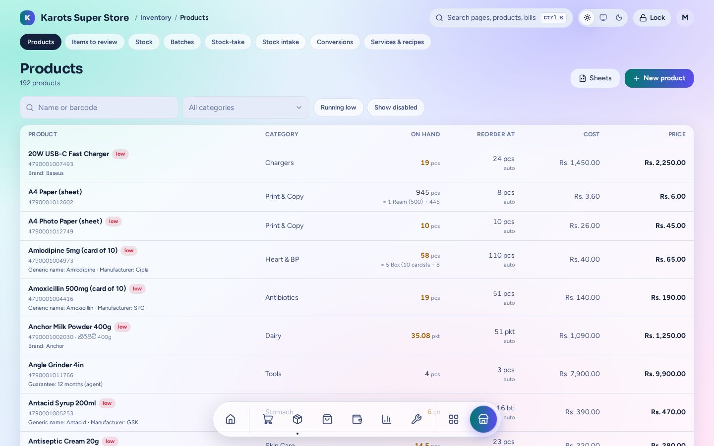
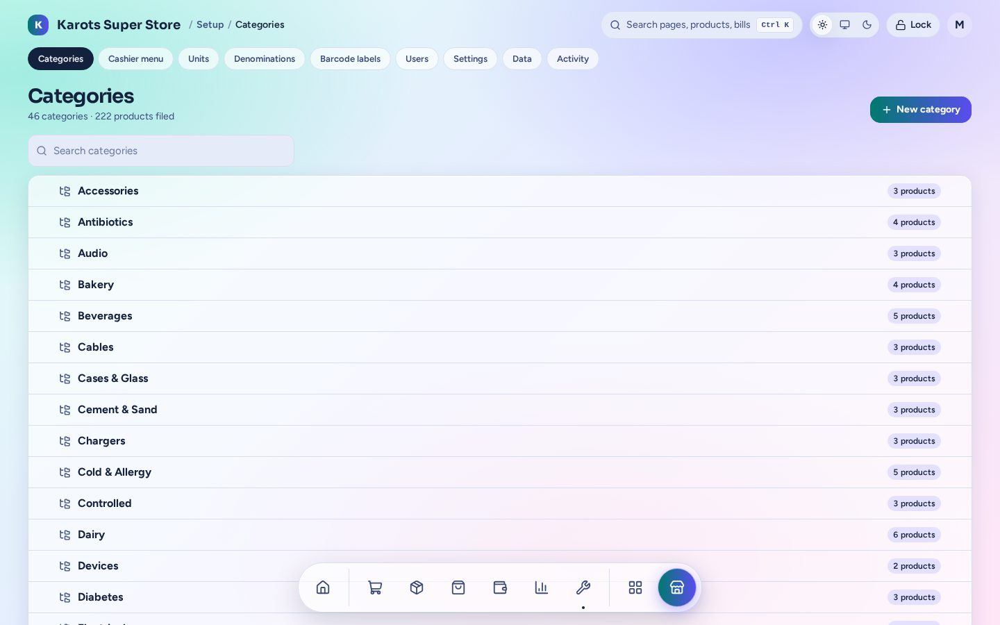
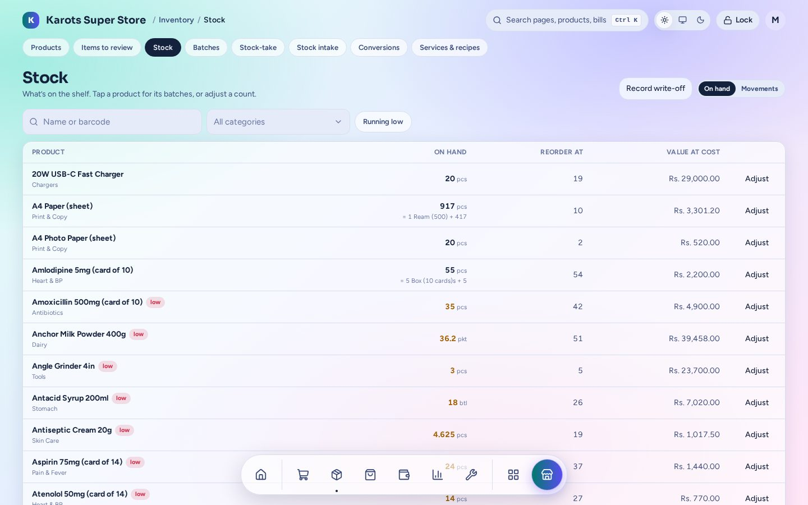
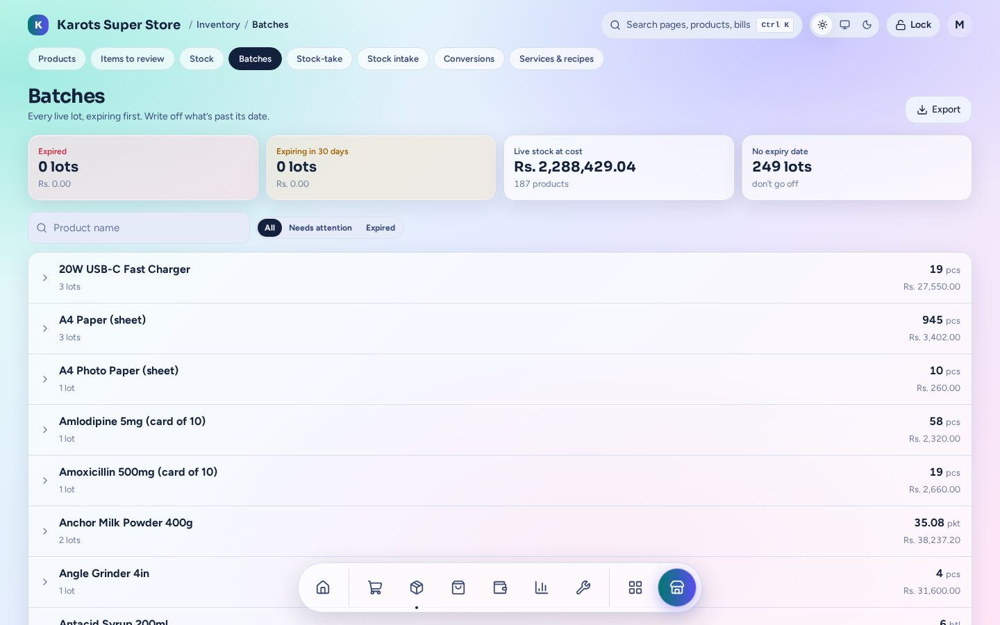
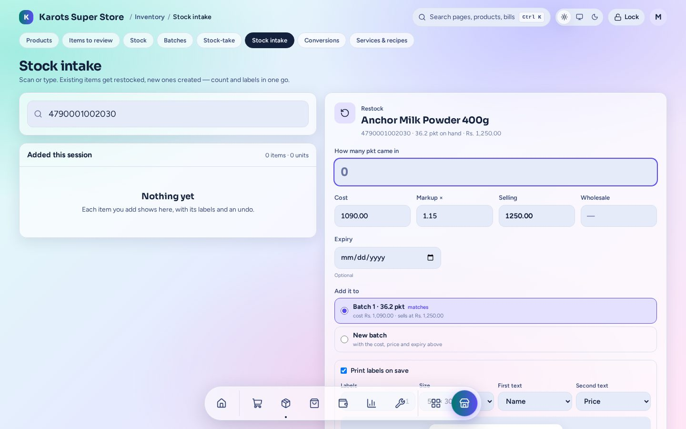
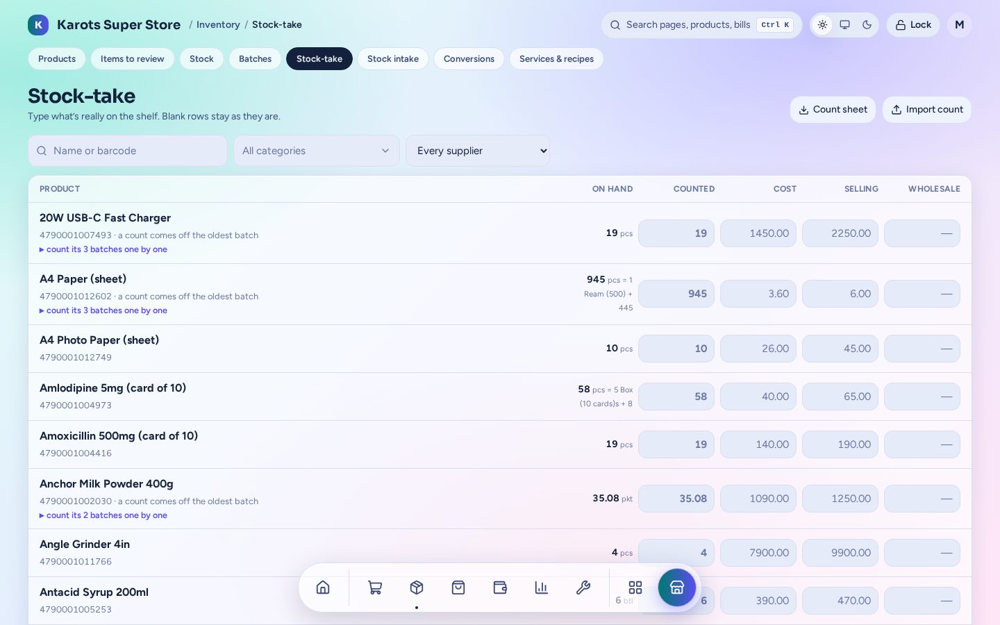

# Stock

Everything about what's on the shelf lives under **Inventory**: products, stock levels, batches,
stock-take, intake and conversions. Admins and managers can use it on a phone too.

## Products

- **New product:** name (in English and in Sinhala or Tamil if you like), barcode (one or more),
  category, unit, cost, price, wholesale price and reorder level.
- **Packs:** a product can sell whole or loose, such as a card of 10 tablets, a ream of 500
  sheets or a 25 kg sack. The till asks "loose or pack?" and stock is kept in the smallest unit.
- **Items to review:** quick items sold at the till and anything else that needs a look.
- **Sheets:** export the product list to Excel / CSV / ODS, change it and import it back. A
  price-only sheet changes prices only.
- **Merge:** two products that are really one become one, and their sales, stock and plugin
  records move with them.

Categories, units, the cashier menu (the groups on the till) and services & recipes (a tea made
from milk powder and sugar takes its ingredients off stock) are each a tab of their own.

## Stock levels

**On hand** shows each product's stock, reorder level and value at cost. Tap a product to see its
batches or **Adjust** a count. **Movements** lists every change with who made it and why.
**Record write-off** takes damaged or expired stock out.

## Batches and expiry

Stock received with an expiry date is kept as a batch. The till sells the oldest batch first, and
asks before selling an expired one: sell anyway, write it off, or go back. The page shows what has
expired, what expires within 30 days and the value of live stock.

## Stock intake

Scan or type to receive stock without a purchase order. An existing product is restocked (how
many came, cost, selling price, expiry, which batch). An unknown barcode opens a new product. You
can print the labels as you save.

## Stock-take

Type what's really on the shelf. Blank rows stay as they are. Print a **count sheet** by category
or supplier to count on paper, or **import** a count from a spreadsheet. The differences are
saved as adjustments.

## Smart reorder levels

Each product's reorder level is **Auto** by default. Every night at 03:00 the suite learns it
from recent sales, how often the supplier comes, last year's same weeks and a few safety days.
It ignores one-off big bills. The Reorder page and the till's Low stock tab show the reason
behind each level. Set a number yourself to turn Auto off for that product.

See [Purchasing → Reorder](purchasing.md#reorder) for turning low stock into orders.
