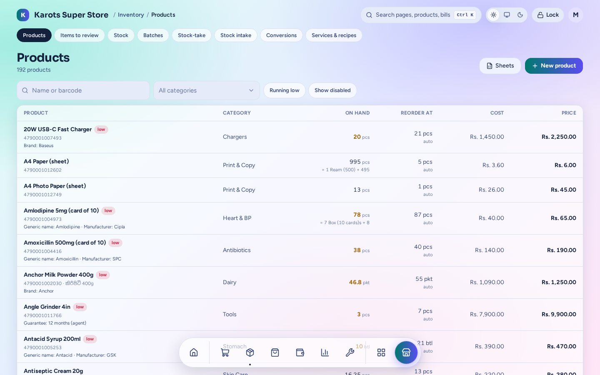
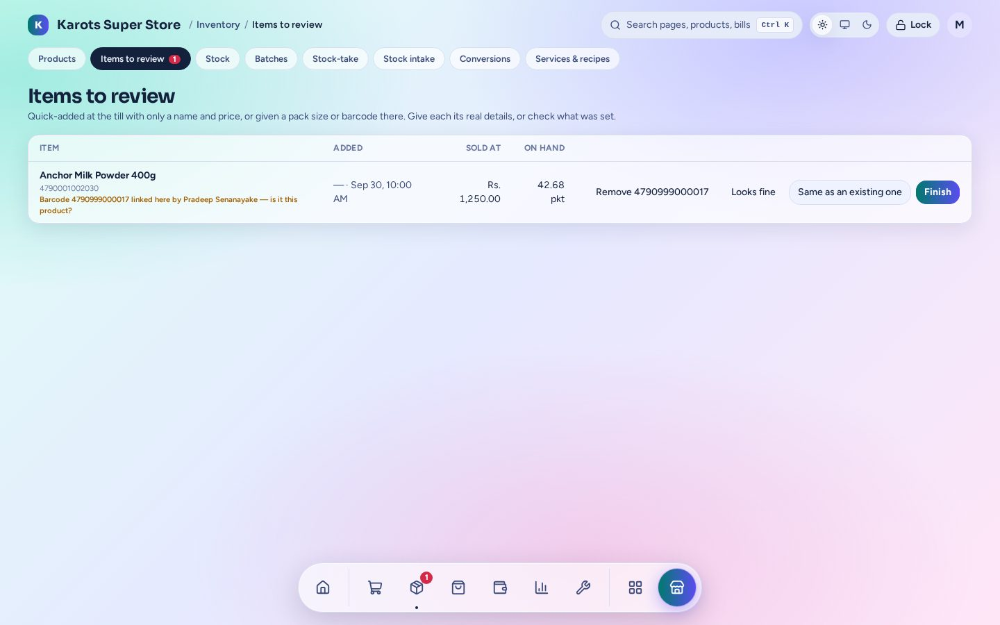
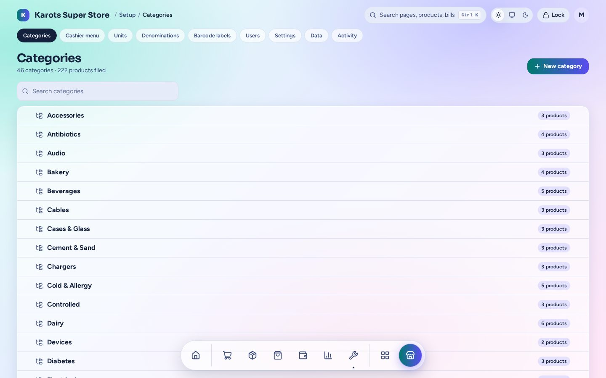
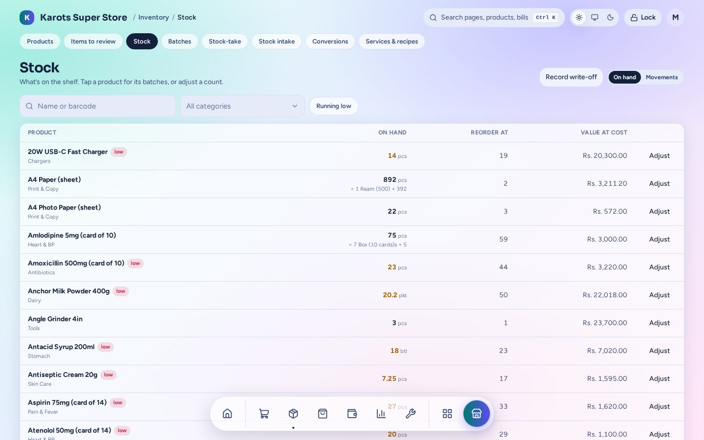
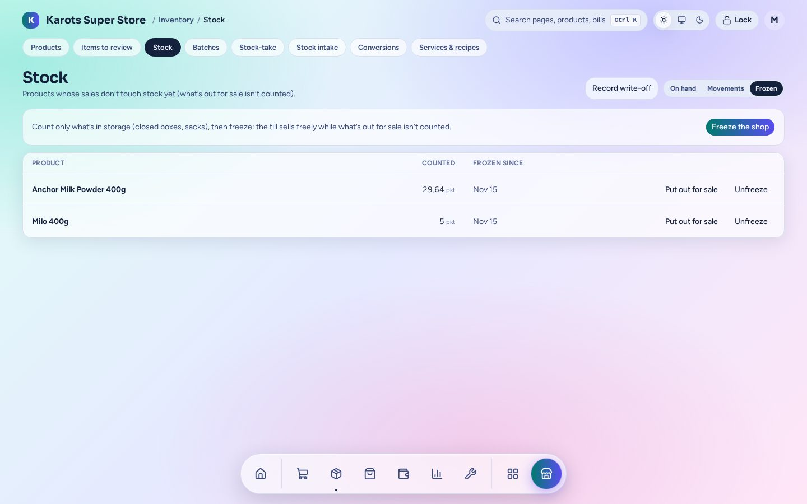
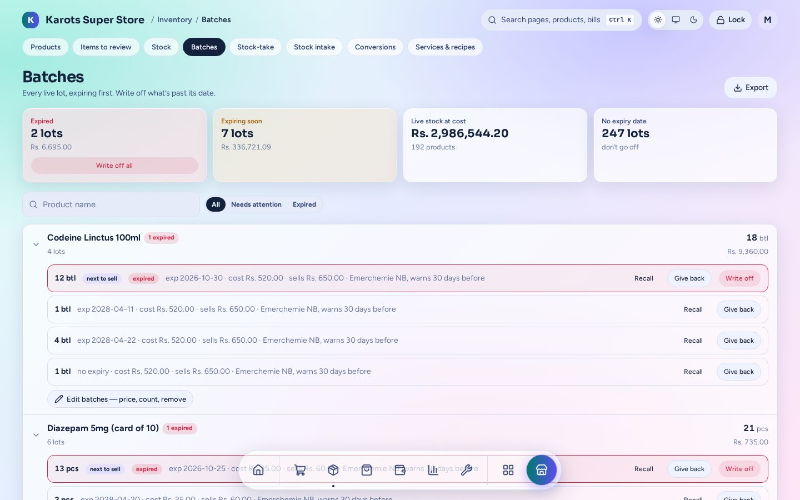
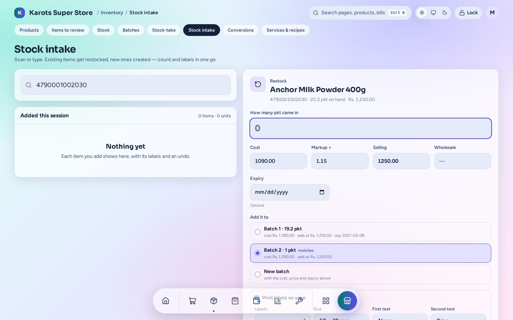
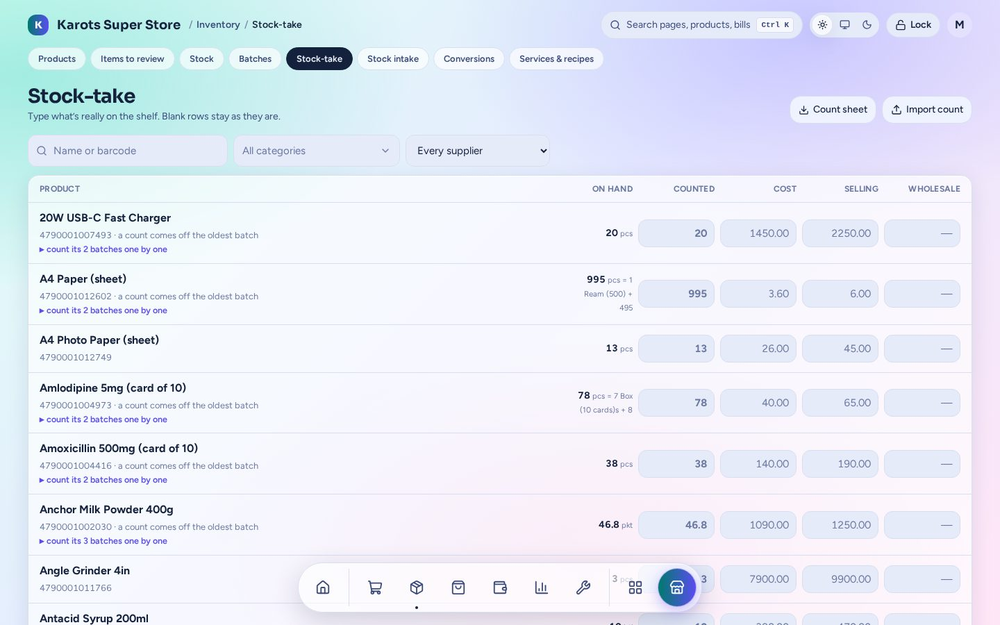

# Stock

Everything about what's on the shelf lives under **Inventory**: products, stock levels, batches,
stock-take, intake and conversions. Admins and managers can use it on a phone too.

## Products

- **New product:** name (in English and in Sinhala or Tamil if you like), barcode (one or more),
  category, unit, cost, price, wholesale price and reorder level.
  Packs (a card of 10) and extra barcodes can be added while creating it, or later.
- **Packs:** a product can sell whole or loose, such as a card of 10 tablets, a ream of 500
  sheets or a 25 kg sack. The till asks "loose or pack?" and stock is kept in the smallest unit.
  A pack holds a whole number of them.
- **Items to review:** quick items sold at the till, barcodes and pack sizes a cashier set, and anything
  else that needs a look. A barcode a cashier linked works straight away; **Looks fine** keeps it, and
  **Remove** makes the code unknown again. Removing doesn't move stock already received against it, so
  check the count on both products if the screen warns you. A cashier's new product that turns out to
  exist already can be merged with **Same as an existing one**.

  

- **Sheets:** export the product list to Excel / CSV / ODS, change it and import it back. A
  price-only sheet changes prices only. To tidy the whole list (names, categories, Product Plus
  fields), tick **Include ref** before exporting: each row then carries its product's ref, and the
  import updates that same product even after a rename or with no barcode. Sales, stock and
  batches stay with it. A ref from another shop's sheet is refused.
  **Import shows what will change first:** choosing the sheet previews it (nothing changes yet) —
  how many products update, which are new, which lines are skipped and why, and for each product
  only the fields that change, old → new (Product Plus fields too), with a search box. **Import**
  then applies exactly that, all at once: if the power goes or a line fails, nothing half-done is
  left behind. A blank cell leaves that field as it is.
- **Merge:** two products that are really one become one, and their sales, stock and plugin
  records move with them.

Categories, units, the cashier menu (the groups on the till) and services & recipes (a tea made
from milk powder and sugar takes its ingredients off stock) are each a tab of their own.
One unit is the shop's **default** (marked on the Units tab; open a unit and tick Default unit to
change it): new products, quick items and services start with it.
A unit counted in **whole** pieces (not ticked for decimals) never takes part of one: counts, intake,
write-offs and conversions want whole numbers; only a recipe may use part of one (a packet of tea used by
the cup). A product can't move to a whole unit while it holds part of one, nor to a decimal unit while it
has packs — count it whole, or remove its packs, first; the same goes for changing a unit's decimals.

## Stock levels

**On hand** shows each product's stock, reorder level and value at cost. Tap a product to see its
batches or **Adjust** a count. **Movements** lists every change with who made it and why.
**Record write-off** takes damaged or expired stock out.

## Freezing stock while a shop starts

A shop that is starting out can't close for a stock take: what's **out for sale** sells all day, so
any count of it is wrong by the time it's finished. So count only what's **in storage** (closed boxes
and sacks, sealed medicine boxes) and **freeze** the stock. A frozen product sells at the till
without asking about stock and without taking it out. Deliveries, stock-takes, conversions and
write-offs still work as usual.

An example. 20 boxes of 10 pencils are in storage: 200, frozen. Pencils sell all morning and stock
stays 200. A box is opened for selling: **Adjust → Put out for sale**, 10, and stock is 190. Those
10 sell without touching it. Later 3 are left out for sale and another box is opened, so 13 are out:
**Unfreeze**, "13 out for sale", and stock is 190 + 13 = 203. From then on every sale takes stock out.

- **Freeze a product** with **Freeze** on its row under **Stock → On hand**. **Stock → Frozen** lists
  what's still frozen (how far you've got), with **Freeze the shop**: every product is frozen, and new
  ones start frozen until the shop is unfrozen. **Unfreeze the shop** first shows the products still
  frozen, since their stock stays at what was counted in storage.
- **Unfreeze** asks one thing: how many are out for sale now (0 is fine). A cashier or a sales person
  can do it from the till's **Frozen** tab, or from the cart in the middle of a sale (the sale stays
  as it is).
- **Adjusting a frozen product** asks what happened. **Put out for sale** opens a box: if the box and
  the single item are two products joined by a [conversion](#products), the conversion runs;
  otherwise type how many, or pick a pack. **Damaged** goes on the damaged list. **Count changed** is
  a recount of what's in storage.
- **Opening a box into a frozen product** with the till's Convert tab, when the box itself isn't
  frozen, asks where the pieces went: **out for sale** (not counted while frozen) or **into storage**
  (added to stock). When both are frozen it doesn't ask: the pieces go out for sale. Conversions → Run
  history marks those runs "out for sale (not counted)".
- **Damage while frozen** asks **was it out for sale or in storage?** Out for sale: the item is added
  as an extra and then written off, so stock stays as counted; the loss is on the damaged list with
  its cost and comes off profit like any other loss. In storage: it comes out of stock as usual. A damaged return is always "out for sale".
- A frozen product never shows as running low. Its sales use its cost price for profit, and the stock
  value report says how many products are frozen (it counts only what's in storage). Returns of a
  frozen product don't go back into stock (they're back out for sale, uncounted).
- A product with several batches still asks **which price?** at the till, and its batches keep the
  counted quantities. The batch only sets the price; selling more than it holds is fine.

## Batches and expiry

Stock received with an expiry date is kept as a batch. The till sells the oldest batch first, and
asks before selling an expired one: sell anyway, write it off, or go back. When no batch is picked
(a sale from a phone that was offline, a write-off with no batch named), good batches go first;
an expired or recalled one only when nothing else is left. A recalled batch can't be merged with
others: give it back, or undo the recall, first. The page shows what has
expired, what is close to expiry and the value of live stock.

**How early a batch warns** is up to you. Set a number of days in **Settings → Stock**, and give a
supplier its own number on their form when they need telling sooner. A batch uses the number of the
supplier who delivered it, or its product's preferred supplier if it didn't come on a delivery;
anything else uses the shop's number. Each batch shows its supplier, so you can see who to call,
and [Give back](purchasing.md#giving-a-batch-back) hands it to them.

## Stock intake

Scan or type to receive stock without a purchase order. An existing product is restocked (how
many came, cost, selling price, expiry, which batch). An unknown barcode asks first whether it's a product you already have, since a new batch often carries a
new barcode: **Same as an existing one** adds the code to that product, or choose **It's a new product**. You
can print the labels as you save. A supplier who isn't listed yet can be added on the spot with **New**, and a
product with no supplier can be given one as you restock it.

## Stock-take

Type what's really on the shelf. Blank rows stay as they are. Print a **count sheet** by category
or supplier to count on paper, or **import** a count from a spreadsheet. The differences are
saved as adjustments. Type the counts in **before selling again**: a count replaces stock as it is
when it's saved, so anything sold between counting and saving would be counted twice.

## Smart reorder levels

Each product's reorder level is **Auto** by default. Every night at 03:00 the suite learns it
from recent sales, how often the supplier comes, last year's same weeks and a few safety days.
It ignores one-off big bills. The Reorder page and the till's Low stock tab show the reason
behind each level. Set a number yourself to turn Auto off for that product.

See [Purchasing → Reorder](purchasing.md#reorder) for turning low stock into orders.
