# Selling at the till

The till is made for a desktop PC or a kiosk at the counter. Cashiers sign in with their phone
number and PIN. After a few idle minutes the till locks itself, and the same cashier or any admin
can unlock it.

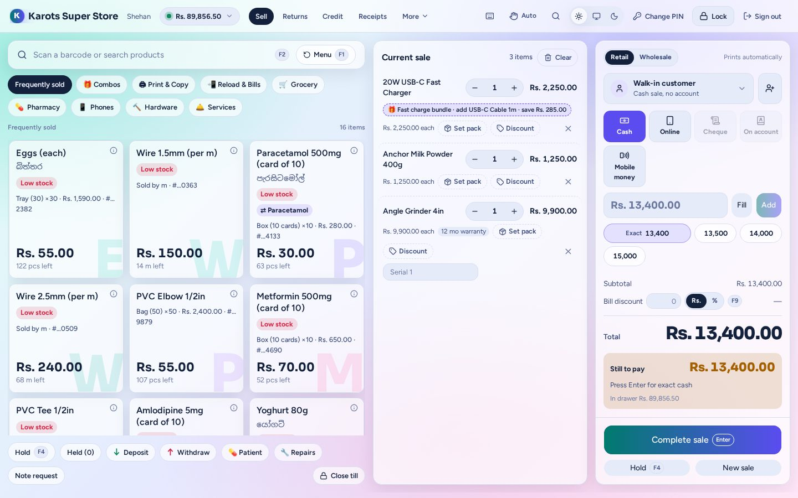

## The sell screen

- **Left:** a search bar (it takes a scanner too), the group chips (Frequently sold, your cashier
  menu groups, plugin menus) and product cards with price and stock.
- **Middle:** the current sale. Change a quantity with − / +, set a pack or loose price, add a
  line discount, or tap a line for its info.
- **Right:** Retail or Wholesale, the customer (walk-in or a credit customer), the tenders
  (cash, card, online and the rest), quick cash buttons, the bill discount and **Complete sale**.

Search finds a product by its name or its **local name** (Sinhala / Tamil, set on the product), and
every word you type may match either. Scanning a barcode adds the product. If a search finds nothing, pressing Enter adds it as a
**quick item** with a name and price, and the item goes to admin's review list. A sale is never
blocked: anything odd (selling below stock, a missing price) is sold first and flagged for review.

### Keys

| Key | Does |
|---|---|
| **F1** | Back to the menu. Clears the **search only**, never the cart |
| **F2 / F3** | Jump to search |
| **F4** | Hold the sale |
| **F9** | Bill discount |
| **F10** | Go to the amount; then **Enter** completes the sale |
| **Enter** after a sale | Start the next sale |
| **Esc** | Leave the field you're in |

Only **New sale** clears the cart. On a kiosk the browser's own keys are switched off: no F5
reload and no right-click outside text boxes.

### Paying

- Split the bill across tenders, use **Fill** to put the rest on one tender, and keep the change
  as the customer's advance (**Keep** / **Keep all**).
- **On account** sells on credit to a customer with a limit. A cashier can't go over the limit,
  but an admin can approve it.
- **Cheque** takes a cheque from a named customer (bank, number, date). It goes into Cheques in
  hand and prints on the receipt; an admin marks it cleared or bounced later (see
  [Money → Cheques](money.md#cheques)).
- When change is short in the drawer, the till warns you. It doesn't stop the sale.

### Holds

**Hold** (F4) parks the sale and frees the till. Resume a held sale from the Hold list. The till
won't resume one over a cart that already has items in it.

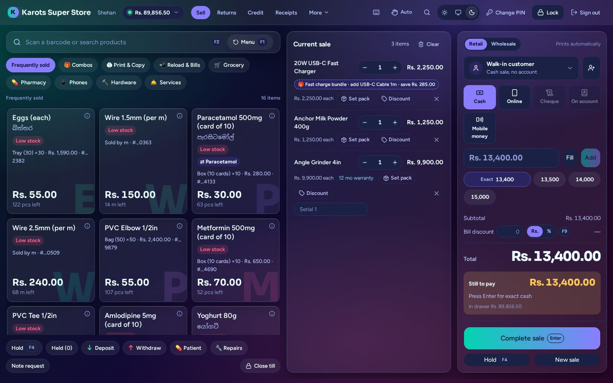

## Opening and closing the till

Each cashier opens their till by counting the float note by note. Deposits and withdrawals move
cash to a [locker](money.md#lockers). At close the cashier counts again, the till shows what it
should hold, and any over / short is recorded. A till left open overnight shows on the dashboard,
where an admin or manager can close it for the cashier.

## Counter tabs

The tabs along the top do the counter's other jobs without leaving the till. **F1** on any tab
goes back to Sell.

### Returns

Find the sale by receipt number, customer, phone or product. Pick what's coming back and why; the refund is what was paid for it.

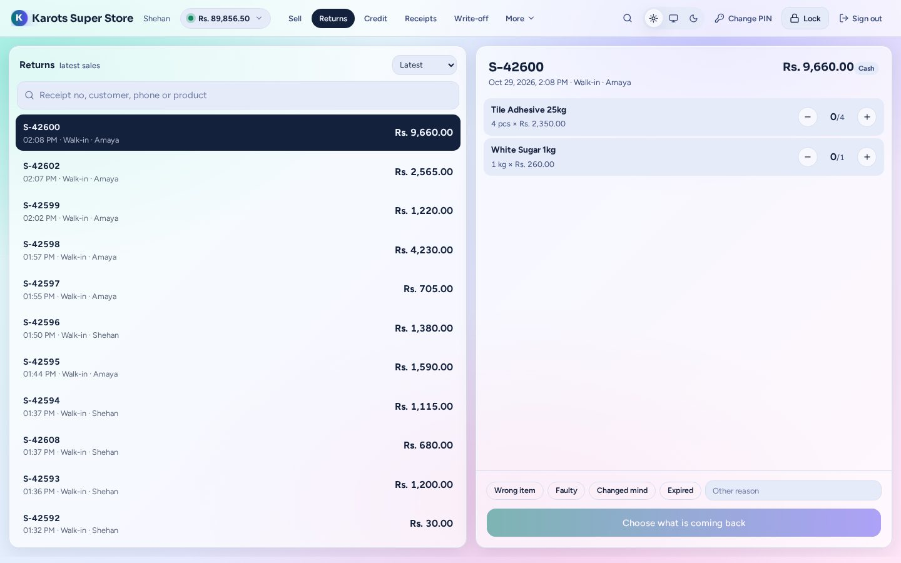

### Credit

Customers who owe the shop. Take a payment or an advance (by cash, card, online or one or more
cheques), or refund one.

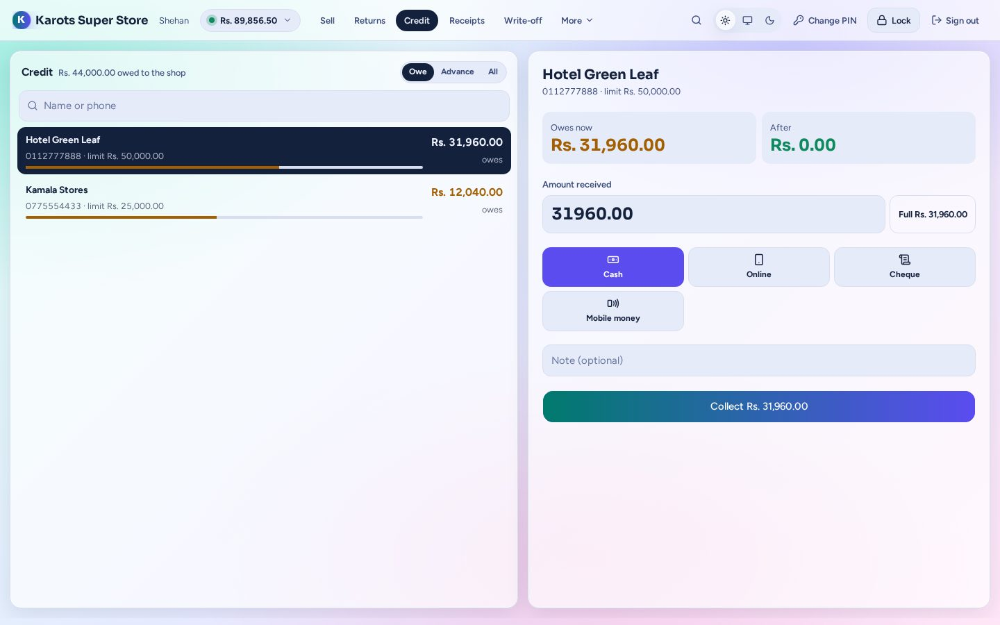

### Receipts

Every slip of the shift (sales, cash, credit, warranty). Print one again at 80 or 58 mm, or as A4 / PDF.

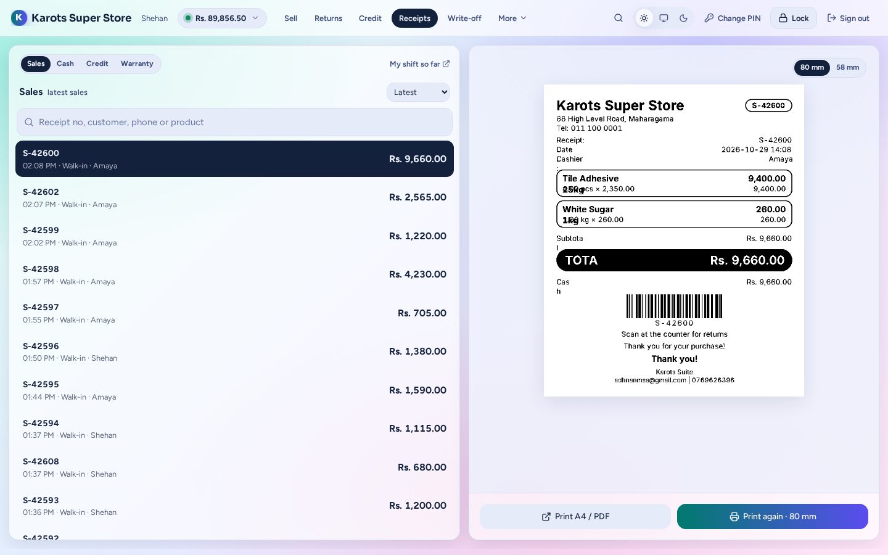

### Write-off

Take damaged, expired or shop-use stock out, from the oldest batch first.

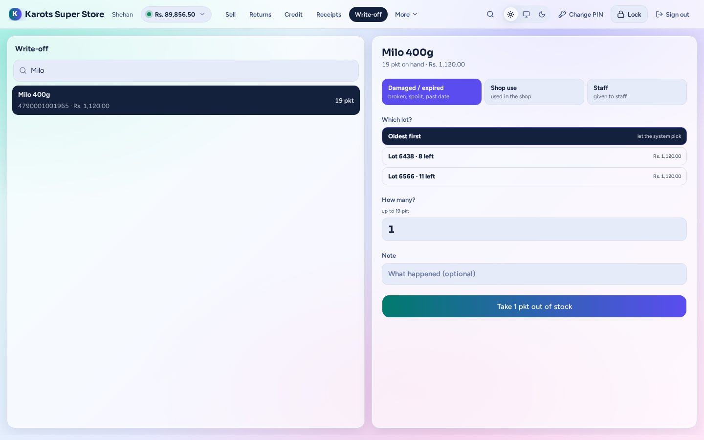

### Convert

Break open a pack (a 25 kg sack into 1 kg bags) and record what actually came out.

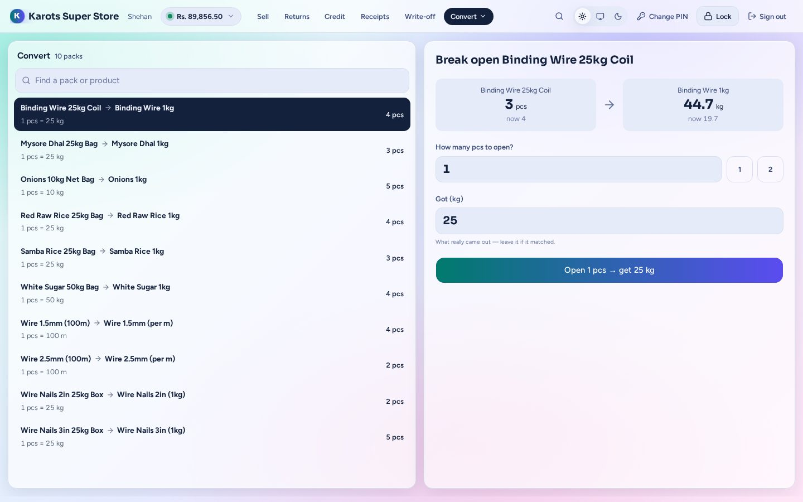

### Labels

Print barcode labels for a product.

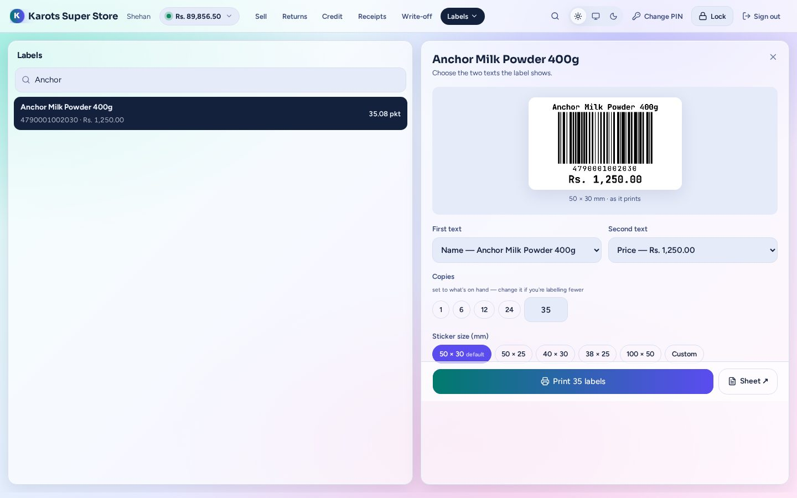

### Low stock

What will run out before the next delivery, by supplier (if the cashier may see it).

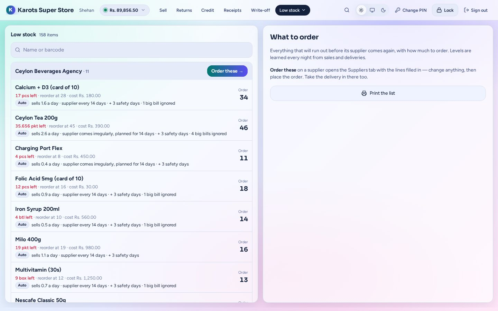

### Warranty

Find a unit by serial or receipt and swap it under warranty.

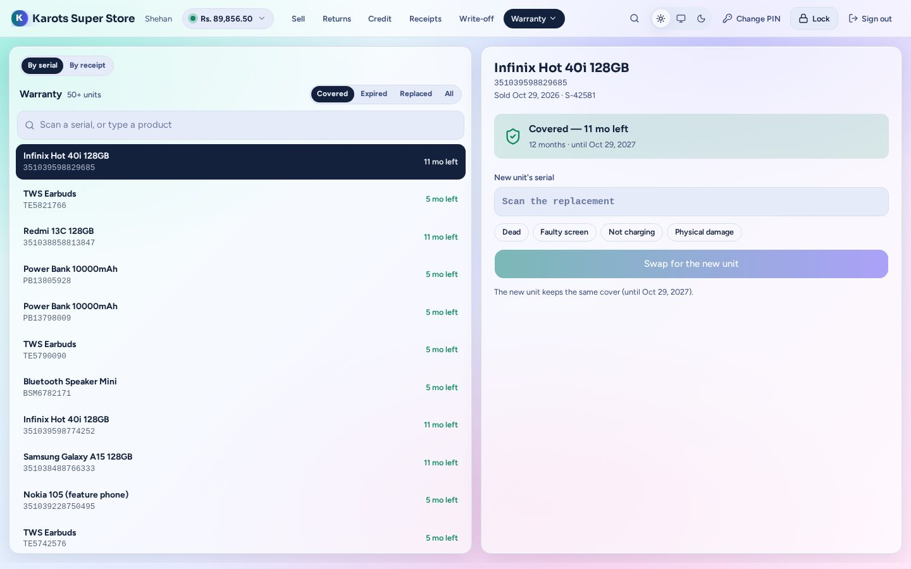

### Suppliers

Pay a supplier (cash, or a cheque on a bank account the cashier may use), receive stock or place
an order at the counter (if the cashier may handle suppliers).

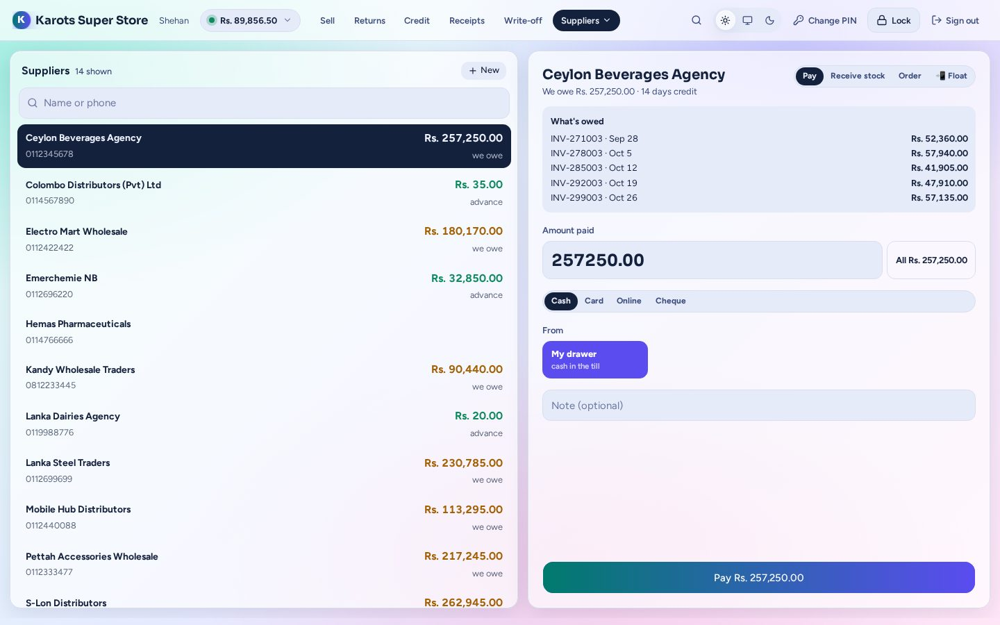

### Expenses

Pay a shop expense from the drawer, or by cheque.

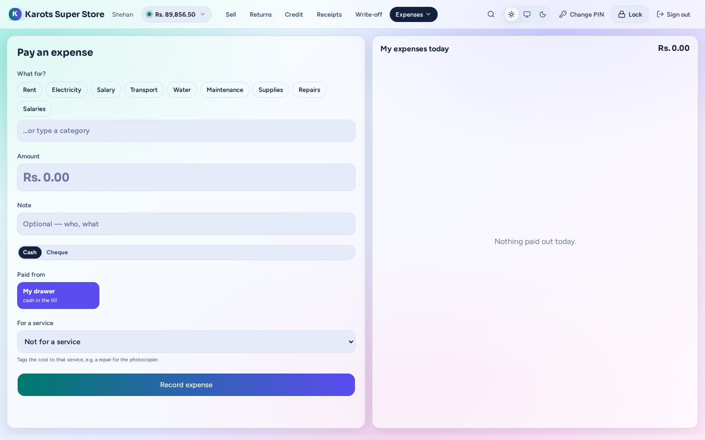

What each cashier sees here is set per user: see [People & users](people.md#users-and-rights).
