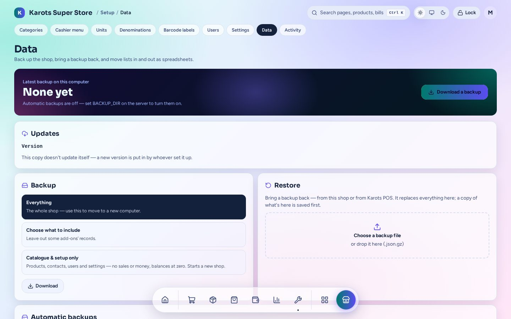

# Updates & backups

Everything here is on **Setup → Data** (admins only).

## Updates

Shops **never update by themselves**. When you **Release** a new build from the Shop Builder, it
is signed with your release key and put in the shop's folder in the Karots bucket. At the shop:

1. **Setup → Data → Updates** shows the version running and whether a newer one is published.
2. Press **Update**. The suite downloads the update, checks its signature, swaps the program and
   restarts.
3. If the new version fails to start, it rolls back to the old one by itself.

> Keep a copy of `SUITE_RELEASE_KEY`. Shops only accept updates signed with it.

A changed **profile** (plugins, ports, database mode) needs the Builder and **karots-setup →
Update**, not just this button. See [Install](install.md#changing-a-shop-later).

## Backups

- **Automatic backups** run every few hours on the main PC and the newest ones are kept. In
  file mode they're in `data/backups`; in server mode, in the install folder's `backups`.
- **Download a backup** any time:
  - **Everything:** the whole shop. Use this to move to a new computer.
  - **Choose what to include:** leave out some plugins' records.
  - **Catalogue & setup only:** products, contacts, users and settings, with no sales or money
    and balances at zero. Use it to start a new shop from an old one.
- **Restore** a backup file (from this shop or from Karots POS). The suite saves a safety copy
  first, and the report lists what came back and anything odd it found in the data.

## Backup copies

Every automatic backup can also be copied away from the PC:

| | Copy folder | Karots cloud |
|---|---|---|
| Where | A USB stick, another drive or a network share | Karots' own storage, one folder per shop |
| Who turns it on | The shop's admin, on the Data page (or preset in the Builder) | Karots, for paying shops |
| Files | Plain backup files, so the owner can bring the shop back with only the file | Encrypted per shop, about one a day |
| Switch off | The admin | The admin can switch it off; only Karots can switch it on |

A copy that hasn't worked for a day shows on the dashboard. **Backups here…** on each copy lists
its files, and **Restore** brings one back through the normal restore.

## Bringing a shop back

On a new PC, run **karots-setup** with the shop's three files and a backup. Setup offers it
under **Bring back a shop**. See [Moving a shop](install.md#moving-a-shop-to-another-pc).
